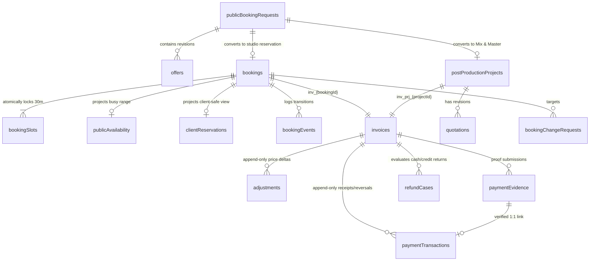

# BOOKING LIFECYCLE & RESERVATION ENGINE DATA CONTRACTS (PHASE 0 ARCHITECTURE FREEZE)

**Project:** 37 Music Studio (`37V2`)  
**Repository:** `https://github.com/jangangitungapah-pixel/37V2`  
**Target Branch:** `main`  
**Audited Baseline HEAD SHA:** `6ef8f0cab8f66a439309deb9b2a63488695a615a`  
**Phase:** Phase 0 — Architecture Freeze (Specification Only — No `firestore.rules` or Schema Code Modified)  
**Date:** 25 November 2026  

---

## 1. Entity Topology & Collection Architecture

To avoid unnecessary collection proliferation and Firestore index sprawl while enforcing clean domain isolation under Firebase Spark:

| Entity / Path | Kind | Status vs `main` | Owner / Authority |
|---|---|---|---|
| `settings/bookingPolicies` | Singleton Doc | **New** (Design) | Owner write / Staff read |
| `publicPricingCatalog/current` | Singleton Doc | **Extend** (Schema v4) | Owner write / Public read |
| `publicBookingRequests/{requestId}` | Top-Level Coll. | **Extend** | Public/Client create; Staff update |
| `publicBookingRequests/{requestId}/offers/{offerId}` | Subcollection | **New** (Design) | Staff create/revise; Client accept/reject |
| `publicBookingRequests/{requestId}/communications/{eventId}` | Subcollection | Existing (Keep) | Staff append-only |
| `publicBookingRequests/{requestId}/activities/{eventId}` | Subcollection | Existing (Keep) | Staff + transactional Client offer-event append |
| `bookings/{bookingId}` | Top-Level Coll. | **Extend** (Schema v2) | Staff write only (Client NO read) |
| `bookingSlots/{date}__{studioId}__{slotStartMinute}` | Top-Level Coll. | Existing (Keep) | Staff write only (Client NO access) |
| `publicAvailability/{bookingId}` | Top-Level Coll. | Existing (Keep) | Staff write / Public read (zero PII) |
| `clientReservations/{bookingId}` | Top-Level Coll. | **New Projection** | Staff write (synced atomically w/ `bookings`) / Client read own only |
| `bookingEvents/{eventId}` | Top-Level Coll. | Existing (Extend enum) | Staff append-only |
| `invoices/{invoiceId}` (`inv_{bookingId}` \| `inv_prj_{projectId}`) | Top-Level Coll. | **Extend** (Additive) | Staff create/update / Client read own |
| `invoices/{invoiceId}/adjustments/{adjustmentId}` | Subcollection | **New** (Design) | Staff/Owner append-only |
| `paymentTransactions/{transactionId}` | Top-Level Coll. | **Extend** (`source`/`targetType`) | Staff append-only / Client read own |
| `paymentEvidence/{evidenceId}` | Top-Level Coll. | Existing (Tighten cash & URL cap) | Client create `client_portal` (`!= cash`) / Staff verify/reject/attach |
| `bookingChangeRequests/{changeRequestId}` | Top-Level Coll. | **New** (Design) | Client/Staff create; Client accept/cancel counter; Staff review/apply |
| `refundCases/{refundId}` | Top-Level Coll. | **New** (Design) | Staff/Owner/Client request; Staff/Owner review/settle; Client read own |
| `postProductionProjects/{projectId}` | Top-Level Coll. | **New** (Design) | Staff create/manage / Client read own |
| `postProductionProjects/{projectId}/quotations/{quotationId}` | Subcollection | **New** (Design) | Staff create; Client accept/reject |
| `postProductionProjects/{projectId}/activities/{activityId}` | Subcollection | **New** (Design) | Staff + Client milestone notes |
| `clientAccounts`, `clientCustomerLinks`, `clientProfiles`, `customers`, `customerPhoneIndex`, `customerEmailIndex` | Existing Auth/CRM | Existing (Additive link audit) | See Section 7 Identity Binding |

---

## 2. Core Data Primitives & Non-Functional Rules

1. **Integer IDR Arithmetic Only:** All monetary amounts (`subtotal`, `discountAmount`, `totalAmount`, `adjustmentTotal`, `effectiveTotalAmount`, `minimumDepositAmount`, `amountPaid`, `refundedTotal`, `creditAppliedTotal`, `balanceDue`, `amount`, `claimedAmount`, `verifiedAmount`) MUST be JavaScript safe integers (`Number.isInteger(x)`). Percentages use basis/percentage integers (`0..100`) rounded explicitly via `Math.round((base * percent) / 100)` once at Offer/Reservation freeze.
2. **Timezone (`Asia/Jakarta` / UTC+7):**
   - Calendar dates: strict `YYYY-MM-DD` strings validated against `Asia/Jakarta` calendar dates.
   - Room slot minutes: integer minutes since midnight in WIB (`600..1380`, multiples of `30`; `10:00 = 600`, `23:00 = 1380`; preserving `HH:30` start compatibility!).
   - Instant points (`holdExpiresAt`, `createdAt`, `updatedAt`, `receivedAt`, `verifiedAt`, `settledAt`): Firestore `Timestamp` (`serverTimestamp()` where applicable, or explicit UTC epoch serialized as `Timestamp` from WIB input e.g. `YYYY-MM-DDTHH:mm:00+07:00`).
3. **Deterministic IDs & Idempotency:** Every mutating operation pre-generates or derives an operation ID before entering `runTransaction`:
   - Invoice: `inv_{bookingId}` (studio) or `inv_prj_{projectId}` (Mix & Master)
   - Initial booking tx: `pay_initial_{bookingId}`
   - Evidence tx: `pay_evidence_{evidenceId}`
   - Staff Cash / manual tx: `pay_{uuid}`
   - Reversal tx: `pay_rev_{originalTransactionId}` (strictly 1 reversal per payment tx)
   - Slot lock: `{YYYY-MM-DD}__{room-a|room-b}__{slotStartMinute}` (double underscore preserved)
   - Offer / Adjustment / Change Request / Refund / Project: `off_{seqOrHex}`, `adj_{uuid}`, `chg_{24hex}`, `ref_{24hex}`, `prj_{20alnum}`, `qt_{uuid}`
4. **Optimistic Concurrency:** Mutable state-bearing documents (`publicBookingRequests`, `offers`, `bookings`, `invoices`, `paymentEvidence`, `bookingChangeRequests`, `refundCases`, `postProductionProjects`, `settings/*`) carry integer `version >= 1` incremented by `+1` on every update.
5. **Dual Client Ownership Standard:** Client portal operational documents (`publicBookingRequests`, `clientReservations`, `invoices`, `paymentTransactions`, `paymentEvidence`, `bookingChangeRequests`, `refundCases`, `postProductionProjects`) carry BOTH `customerId` AND `clientUid` (nullable `''` for walk-in/unclaimed customers, non-empty `uid` when linked or Client Portal-originated), resolving `DISC-05` cleanly.

---

## 3. Detailed Entity Data Contracts

### 3.1 `settings/bookingPolicies` (New Singleton)
- **ID:** `'bookingPolicies'` (`settings` collection).
- **Schema:**
  - `schemaVersion`: `1` (int, immutable)
  - `defaultDepositPolicy`: `{ type: 'none' | 'fixed' | 'percentage', fixedAmount: int >= 0, percentage: int (0..100), calculationBase: 'total_amount' | 'subtotal' }`
  - `defaultHoldPolicy`: `{ defaultHours: int (1..168) | null, minMinutesBeforeSessionStart: int (0..1440), allowPerBookingOverride: bool }` (null means Owner has not configured a TTL; deposit-hold creation must fail closed until configured)
  - `defaultBalanceDuePolicy`: `{ trigger: 'before_session' | 'at_check_in' | 'before_delivery', offsetHoursBeforeStart: int (0..168) }`
  - `serviceOverrides`: `map<serviceTypeId, { depositPolicy?: ..., holdPolicy?: ..., balanceDuePolicy?: ... }>` (max 20 entries)
  - `optionOverrides`: `map<serviceOptionId, { depositPolicy?: ..., holdPolicy?: ..., balanceDuePolicy?: ... }>` (max 100 entries)
  - `version`: int `>= 1`, `updatedAt`: `Timestamp`, `updatedByUid`: `string`.
- **Ownership & Security:** Owner `create`/`update`; Active Staff `get`; Client/Public `none` (Client receives customer-safe subset via `publicPricingCatalog/current.depositPolicies`).

### 3.2 `publicPricingCatalog/current` (Extended Projection — Schema v4)
- **Additions to existing 5 keys:**
  - `schemaVersion`: bump `3 -> 4`
  - `policyVersion`: int matching `settings/bookingPolicies.version`
  - Each `serviceTypes[]` and `options[]` item may include sanitized `depositPreview: { type: 'none' | 'fixed' | 'percentage', fixedAmount: int, percentage: int, balanceDueTrigger: string }`.
  - Strips all internal commissions, fees, `operationalSettings`, and internal staff notes.

### 3.3 `publicBookingRequests/{requestId}` (+ Subcollection `offers/{offerId}`)

#### Parent `publicBookingRequests/{requestId}` Additions (Compatible w/ 33-key Public & 38-key Client Portal)
- **Existing statuses preserved + clear progression:** `'new' | 'in_review' | 'awaiting_customer' | 'offer_sent' | 'accepted' | 'confirmed' | 'declined' | 'closed'`.
- **Additive Fields:**
  - `activeOfferId`: `string | null` (pointer to latest non-superseded offer)
  - `activeOfferSummary`: `null | { offerId, revisionNumber, mode: 'quote_only' | 'deposit_hold_offer', totalAmount, minimumDepositAmount, holdExpiresAt, offerExpiresAt, status }` (client-safe card summary)
  - `linkedProjectId`: `string | null` (exclusive with `linkedBookingId` — Mix & Master only!)
  - `convertedAt`: `Timestamp | null`, `convertedByUid`: `string` (`''` if unconverted)
- **Invariant:** `!(linkedBookingId != null && linkedProjectId != null)` — a studio request converts ONLY to a studio booking; a WFA request converts ONLY to a Mix & Master project.

#### New Subcollection: `publicBookingRequests/{requestId}/offers/{offerId}`
- **ID:** `off_{20hex}` (sequential display code `offerNumber`: `'OFF-01'`, `'OFF-02'`).
- **Fields & Mutability:**

| Field | Type | Mutability | Description |
|---|---|---|---|
| `schemaVersion` | `1` | IMMUTABLE | Contract version |
| `offerId`, `offerNumber`, `revisionNumber` | `string`, `string`, `int >= 1` | IMMUTABLE | Monotonic per request |
| `requestId`, `clientUid`, `customerId` | `string` | IMMUTABLE | Ownership bindings (`clientUid` copied from request) |
| `offerMode` | `'quote_only' \| 'deposit_hold_offer'` | IMMUTABLE | Determines if provisional `bookingSlots` hold exists during Offer review |
| `provisionalBookingId` | `string \| null` | IMMUTABLE | Set iff `offerMode == 'deposit_hold_offer'` |
| `scheduleSnapshot` | `map` (7 keys: `studioId, studioName, date, startMinute, endMinute, durationMinutes, timeZone`) | IMMUTABLE | Locked room/date/time in WIB |
| `serviceSnapshot` | `map` (`serviceTypeId, serviceTypeName, serviceOptionId, serviceOptionName, pricingMode, pricingSettingsVersion`) | IMMUTABLE | Selected catalog V2 option |
| `financialSnapshot` | `map` (`unitRate, subtotal, discountAmount, automaticDiscount, totalAmount`) | IMMUTABLE | Integer IDR customer quote (ZERO internal commissions/fees!) |
| `depositPolicySnapshot` | `map` (`type, fixedAmount, percentage, minimumDepositAmount, calculationBase, policySource: 'default'\|'service_override'\|'option_override'\|'custom_offer', policyVersion`) | IMMUTABLE | Frozen deposit obligation (`AD-02`) |
| `holdDeadline` | `Timestamp \| null` | IMMUTABLE | When resulting/provisional hold expires (`holdExpiresAt`) |
| `balanceDuePolicy` | `map` (`trigger, dueDate`) | IMMUTABLE | Due policy snapshot (`OD-03`) |
| `offerExpiresAt` | `Timestamp` | IMMUTABLE | Validity window for Client acceptance |
| `staffNoteToClient` | `string` (0..500) | IMMUTABLE | Customer-safe notes |
| `status` | `'sent' \| 'accepted' \| 'rejected' \| 'superseded' \| 'withdrawn' \| 'expired'` | MUTABLE_VIA_TX | Lifecycle state |
| `supersededByOfferId` | `string \| null` | MUTABLE_ONCE | Filled on revision (`OD-13`) |
| `respondedAt`, `respondedByUid`, `responseReason` | `Timestamp\|null`, `string`, `string` | MUTABLE_ONCE | Client acceptance/rejection or Staff withdraw/expire audit |
| `createdAt`, `createdByUid`, `updatedAt`, `updatedByUid`, `version` | Standard | Audit / Monotonic | Optimistic concurrency (`version + 1`) |

### 3.4 Reservation, Slots & Projections (`bookings`, `bookingSlots`, `publicAvailability`, `clientReservations`)

#### `bookings/{bookingId}` (Schema V2 — Canonical Staff Record)
Preserves ALL 45 existing Schema V1 fields (for 100% compatibility with `commission`, `customer`, `reviewInvitations`, `bookingSlots`) PLUS additive V2 Lifecycle fields:
- `schemaVersion`: `1 | 2` (legacy = `1`/absent; new = `2`)
- `source`: `'admin_direct' | 'public_request_conversion' | 'client_portal_offer' | 'legacy_import'` (IMMUTABLE)
- `sourceRequestId`: `string | null` (IMMUTABLE)
- `acceptedOfferId`: `string | null` (IMMUTABLE once bound)
- `clientUid`: `string` (`''` if walk-in without Client Portal link; populated if Client Portal request or linked customer — **fixes `DISC-05`!**)
- **`reservationStatus`**: `'deposit_hold' | 'confirmed' | 'expired' | 'cancelled'` (**Separated from `sessionStatus`!**)
- **`sessionStatus`**: `'pending_confirmation' | 'upcoming' | 'in_progress' | 'completed' | 'no_show' | 'cancelled'` (`'completed'`, `'no_show'`, `'cancelled'` preserved identically for Commission & Reviews!)
- `depositPolicySnapshot`: `{ type, fixedAmount, percentage, minimumDepositAmount, policyVersion }` (IMMUTABLE; `null` only on normalized legacy V1 records)
- `holdExpiresAt`: `Timestamp | null` (nullable when `none` or already `confirmed`; updated only on Manual Hold Extension)
- `holdExtensionCount`: `int >= 0`
- `holdLastExtendedAt`: `Timestamp | null`, `holdLastExtendedByUid`: `string`, `holdLastExtensionReason`: `string`
- `confirmedAt`: `Timestamp | null`, `confirmedByUid`: `string`, `confirmationSource`: `'deposit_verified' | 'no_deposit_policy' | 'staff_override' | 'legacy_confirmed' | null`, `confirmationOverrideReason`: `string`
- `expiredAt`: `Timestamp | null`, `expiredByUid`: `string`, `expiryReason`: `string`
- `cancelledAt`: `Timestamp | null`, `cancelledByUid`: `string`, `cancellationType`: `'client_cancel' | 'studio_cancel' | 'hold_expired' | 'no_show' | null`, `cancellationReason`: `string`
- `invoiceId`: `string` (`inv_{bookingId}`, IMMUTABLE)

#### `clientReservations/{bookingId}` (New Customer-Safe Mirror Projection)
- **ID:** Exact same `bookingId` (`bkg_<uuid>`) for 1:1 transactional lookup/sync.
- **Ownership:** `customerId` (`string`), `clientUid` (`string`). Readable ONLY by active Staff OR owning Client (`isClientOwnerOfDoc(resource.data)`). Clients **cannot create, update, or delete** (`allow write: if isActiveStaff()`).
- **Strict PII/Internal Stripping (NFR):** Explicitly **EXCLUDES** `commissionSnapshot`, `fees`, staff internal `notes`, `phoneNormalized`, `createdByUid`/`updatedByUid` internal UIDs.
- **Exact Synced Fields (27 keys):** `schemaVersion: 2`, `bookingId`, `bookingReference`, `customerId`, `clientUid`, `sourceRequestId`, `acceptedOfferId`, `invoiceId`, `studioId`, `studioName`, `serviceTypeName`, `serviceOptionName`, `date`, `startMinute`, `endMinute`, `durationMinutes`, `timeZone: 'Asia/Jakarta'`, `reservationStatus`, `sessionStatus`, `holdExpiresAt`, `effectiveTotalAmount`, `minimumDepositAmount`, `depositStatus`, `paymentStatus`, `createdAt`, `updatedAt`, `version`.
- **Guarantees:** Eliminates stale `/portal/bookings` (`DISC-06`) and exposes walk-in bookings tied to a linked client!

#### `bookingSlots/{date}__{studioId}__{slotStartMinute}` & `publicAvailability/{bookingId}`
- **Unchanged shape** (`bookingSlots` 5 keys; `publicAvailability` 6 keys zero-PII).
- **Tightened Semantics:** Exist IFF `bookings/{bookingId}.reservationStatus in ['deposit_hold', 'confirmed'] && sessionStatus in ['pending_confirmation', 'upcoming', 'in_progress', 'completed']`. Atomically deleted on `reservationStatus -> 'expired' | 'cancelled'` OR `sessionStatus -> 'no_show' | 'cancelled'`.

### 3.5 Financial Contracts (`invoices`, `invoices/{id}/adjustments`, `paymentTransactions`, `paymentEvidence`)

#### `invoices/{invoiceId}` (Extended Additive Contract)
- **ID:** `inv_{bookingId}` (Studio Reservation) OR `inv_prj_{projectId}` (Mix & Master Project).
- **Target Ref:** `targetType`: `'booking' | 'project'` (`bookingId`: string | null, `projectId`: string | null; legacy defaults `'booking'`), `clientUid`: `string` (`''` or `uid` — fixes `DISC-05`!).
- **Immutable Snapshots (NEVER altered after creation):** `financialSnapshot: { subtotal, discountAmount, totalAmount }`, `customerSnapshot`, `bookingSnapshot` (nullable for `'project'`) / `projectSnapshot` (`{ projectTitle, serviceTypeName, serviceOptionName, targetDeadline, trackCount }`, nullable for `'booking'`), `depositPolicySnapshot`.
- **Evidence & Channel Policy (`clientPaymentPolicy` — replaces coarse `clientPaymentEvidenceRequired`):**
  - `origin`: `'client_portal' | 'public_request' | 'admin_direct' | 'legacy'` (IMMUTABLE)
  - `requireEvidenceForClientNonCash`: `bool` (`true` for Client Portal; prevents Clients bypassing proof verification)
  - `allowStaffCashDirect`: `true` (**Fixes `DISC-02` + enforces `AD-03`:** Staff Cash is ALWAYS permitted without waiting for client upload)
  - *(Note: retain legacy boolean `clientPaymentEvidenceRequired` synced during transitional dual-read phase).*
- **Live Computed Aggregate Fields (Updated ONLY atomically inside ledger transactions):**
  - `adjustmentTotal`: `int` (signed; sum of all docs in `/adjustments`; default `0`)
  - `effectiveTotalAmount`: `int >= 0` (`financialSnapshot.totalAmount + adjustmentTotal`, guarded `>= 0`)
  - `amountPaid`: `int >= 0` (`SUM(paymentTransactions where payment) - SUM(reversal)`)
  - `refundedTotal`: `int >= 0` (sum of `refundCases` where `status == 'settled'`)
  - `creditConvertedTotal`: `int >= 0` (sum of `refundCases` where `status == 'converted_to_credit'`)
  - `overpaidCreditBalance`: `int >= 0` (`Math.max(0, amountPaid - effectiveTotalAmount - refundedTotal - creditConvertedTotal)`)
  - `balanceDue`: `int >= 0` (`Math.max(0, effectiveTotalAmount - amountPaid)`)
  - `minimumDepositAmount`: `int >= 0` (copied from `depositPolicySnapshot` — IMMUTABLE)
  - `depositStatus`: `'not_required' | 'awaiting_deposit' | 'partial_below_minimum' | 'met'`
  - `paymentStatus`: `'unpaid' | 'partial' | 'paid' | 'overpaid_credit_pending'` (`'unpaid'` when `amountPaid == 0 && balanceDue > 0`; `'partial'` when `amountPaid > 0 && balanceDue > 0`; `'paid'` when `balanceDue == 0 && overpaidCreditBalance == 0`; `'overpaid_credit_pending'` if downward adjustment created unresolved excess!)
  - `pendingEvidenceCount`: `int >= 0` (optional cache / lock counter depending on `OD-05` & `OD-09`)
  - `dueDate`: `'YYYY-MM-DD' | null` (mutable by Staff)
  - `invoiceStatus`: `'draft' | 'issued' | 'void'` (fix `draft -> issued` rule gap or drop unused `draft`)

#### New Subcollection: `invoices/{invoiceId}/adjustments/{adjustmentId}` (`AD-06`)
- **ID:** `adj_{24hex}` (append-only, `allow update, delete: if false` except Factory Reset).
- **Fields (13 exact keys):** `schemaVersion: 1`, `adjustmentId`, `invoiceId`, `targetType`, `targetId`, `category` (`'duration_change' | 'room_change' | 'service_change' | 'scope_addendum' | 'discount_credit' | 'cancellation_fee' | 'manual_correction'`), `deltaAmount` (`int != 0`, positive increases bill, negative decreases bill), `reason` (`3..300` chars), `linkedChangeRequestId` (`string | null`), `approvedByUid` (`string`), `clientApprovedAt` (`Timestamp | null`), `createdAt` (`Timestamp`), `createdByUid` (`string`).

#### `paymentTransactions/{transactionId}` (Extended Append-Only Ledger)
- Preserves all 15 existing keys (exact append-only `allow update: if false`).
- **Additive/Refined Values:**
  - `targetType`: `'booking' | 'project'` (`projectId`: `string | null`)
  - `clientUid`: `string`
  - `paymentMethod`: `'cash' | 'transfer' | 'qris' | 'other'` (never overwritten after creation!)
  - `source`: `'booking_initial_payment' | 'manual' | 'staff_cash_desk' | 'legacy_initial_snapshot' | 'client_evidence_verified' | 'reversal' | 'credit_application'`
  - `evidenceId`: `string | null` (explicitly links verified `client_portal` or `admin_manual` evidence ID!)
  - **Credit Redemption Rule:** If Owner adopts Studio Credit (`OD-11`), applying an issued credit uses `source: 'credit_application'`, `linkedRefundCaseId: 'ref_...'`, never double-counting cash inflow in Pembukuan!

#### `paymentEvidence/{evidenceId}` (Tightened Existing Contract)
- Preserves 23-key shape; adds optional `clientUid` propagation and `targetType`: `'booking' | 'project'`.
- **Mandatory Tightened Rules:**
  - When `evidenceSource === 'client_portal'`: `paymentMethod` MUST be `in ['transfer', 'qris', 'other']` — **`'cash'` is HARD-FORBIDDEN in UI, Zod, Service, and `firestore.rules` (`AD-03`)!**
  - Synchronize Cloudinary URL cap across config/Zod/Rules to `<= 500` chars and asset dimension cap consistently.
  - Keep `evidenceSource === 'admin_manual'` with `status: 'attached'` for optional Staff transfer/QRIS receipts (`paymentMethod` unrestricted for Staff).

### 3.6 `bookingChangeRequests/{changeRequestId}` (`AD-07`)
- **ID:** `chg_{24hex}` (`allow delete` only via Factory Reset).
- **Fields:**
  - `schemaVersion: 1`, `changeRequestId`, `bookingId`, `invoiceId`, `customerId`, `clientUid`
  - `initiatedBy`: `'client' | 'staff'`
  - `changeType`: `'reschedule' | 'change_room' | 'change_duration' | 'change_service' | 'extend_session' | 'hold_extension' | 'cancellation_request'`
  - `requestedChanges`: `{ date, studioId, startMinute, endMinute, durationMinutes, serviceTypeId, serviceOptionId, holdExpiresAt }` (immutable client/requester proposal)
  - `reason`: `string` (`3..400`)
  - `status`: `'pending_review' | 'awaiting_client_approval' | 'client_approved' | 'approved_applied' | 'rejected' | 'withdrawn' | 'cancelled'`
  - `staffProposal`: `null | { scheduleSnapshot, serviceSnapshot, pricingDeltaAmount, holdExpiresAt, staffNotes, proposedAt, proposedByUid }`
  - `appliedAdjustmentId`: `string | null`, `reviewedByUid`: `string`, `reviewedAt`: `Timestamp | null`, `rejectionReason`: `string`
  - `createdAt`, `createdByUid`, `updatedAt`, `updatedByUid`, `version` (`int >= 1`).

### 3.7 `refundCases/{refundId}` (`AD-04`)
- **ID:** `ref_{24hex}` (`allow delete` only via Factory Reset).
- **Strict Separation:** Completely distinct from `paymentTransactions` `reversal`.
- **Fields:**
  - `schemaVersion: 1`, `refundId`, `targetType`: `'booking' | 'project'`, `bookingId`: `string | null`, `projectId`: `string | null`, `invoiceId`: `string`, `customerId`: `string`, `clientUid`: `string`
  - `triggerCategory`: `'client_cancellation' | 'studio_cancellation' | 'hold_expired_partial_paid' | 'price_reduction_overpaid' | 'duplicate_or_late_transfer' | 'project_cancellation'`
  - `sourcePaymentTransactionIds`: `string[]` (1..20 original `payment` tx IDs whose receipts justify this refund)
  - `maxRefundableAmount`: `int >= 0` (snapshot of net non-refunded receipts on invoice at request creation)
  - `requestedAmount`: `int > 0`
  - `approvedAmount`: `int >= 0 | null` (`<= maxRefundableAmount`)
  - `forfeitedAmount`: `int >= 0 | null` (e.g., studio cancellation retention fee)
  - `resolutionMethod`: `null | 'bank_transfer' | 'cash_refund' | 'studio_credit' | 'no_refund_forfeited'`
  - `status`: `'requested' | 'under_review' | 'approved' | 'settled' | 'converted_to_credit' | 'rejected' | 'cancelled'`
  - `requestReason`: `string` (`3..400`), `decisionReason`: `string` (`0..400`, required `>= 5` on approve/reject)
  - `creditRemainingAmount`: `int >= 0` (set if `status == 'converted_to_credit'`, decremented atomically on credit redemption!)
  - `settlementInfo`: `null | { settledAt, settledByUid, method, referenceNumber, cloudinaryProofAsset }`
  - `reviewedByUid`, `reviewedAt`, `createdAt`, `createdByUid`, `updatedAt`, `updatedByUid`, `version`.

### 3.8 Mix & Master Project Entities (`postProductionProjects`, `/quotations`, `/activities`) (`AD-08`)
- **Parent `postProductionProjects/{projectId}` (`ID: prj_{20alnum}`):**
  - `schemaVersion: 1`, `projectId`, `projectReference`: `'PRJ-XXXXXXXX'`, `sourceRequestId`, `customerId`, `clientUid`, `invoiceId`: `'inv_prj_{projectId}'`
  - `projectTitle`, `bandOrArtistName`, `serviceTypeId` (`'mixing' | 'mastering' | ...`), `serviceTypeName`, `serviceOptionId`, `serviceOptionName`
  - `status`: `'scoping' | 'quoted' | 'awaiting_deposit' | 'waiting_for_materials' | 'in_production' | 'delivery_review' | 'revision_in_progress' | 'completed' | 'cancelled'`
  - `acceptedQuotationId`: `string | null`, `scopeSummary`: `string`, `trackCount`: `int | null`, `maxRevisions`: `int >= 0`, `revisionsUsed`: `int >= 0`
  - `targetDeadline`: `'YYYY-MM-DD' | null`, `materialsRefNotes`: `string` (external Drive/Dropbox link note — never stored in Firebase Storage), `deliveryRefNotes`: `string`
  - `milestones`: `[{ milestoneId, label, dueAmount, triggerStage, status: 'pending'|'paid' }]`
  - `assignedStaffUid`, `createdAt`, `createdByUid`, `updatedAt`, `updatedByUid`, `version`
  - **Zero Room Overlap Guarantee:** Zero `studioId`, `bookingSlots`, `publicAvailability`, or room minutes anywhere!
- **Subcollection `postProductionProjects/{projectId}/quotations/{quotationId}` (`ID: qt_{20hex}`):**
  - Immutable revision terms (`revisionNumber`, `scopeSummary`, `trackCount`, `includedRevisions`, `targetDeadline`, `financialSnapshot`, `depositPolicySnapshot`, `milestones`, `quotationType: 'initial' | 'scope_addendum'`, `validUntil`), `status: 'sent' | 'accepted' | 'rejected' | 'superseded' | 'expired'`.
- **Subcollection `postProductionProjects/{projectId}/activities/{activityId}`:** Append-only project log (quotation accepted, materials submitted/verified, revision requested, delivery uploaded, deadline revised).

---

## 4. Immutable Snapshot Contracts

| Moment of Freeze | Frozen Payload & Target Location | Immune to Future Changes In |
|---|---|---|
| **Offer Created / Sent** | `offers/{offerId}.scheduleSnapshot`, `.serviceSnapshot`, `.financialSnapshot`, `.depositPolicySnapshot` | Global `settings/pricing` edits & `settings/bookingPolicies` edits (`AD-02`, `AD-06`) |
| **Quotation Created / Sent** | `quotations/{qtId}.scopeSummary`, `.financialSnapshot`, `.depositPolicySnapshot`, `.milestones` | Global WFA catalog edits (`AD-02`, `AD-08`) |
| **Reservation Created** | `bookings/{bookingId}` original snapshots + `invoices/{id}.financialSnapshot` + `.depositPolicySnapshot` | Offer edits, global catalog edits, future Adjustments (which go to `/adjustments` subcollection!) |
| **Payment Received / Verified** | `paymentTransactions/{txId}` (amount, `paymentMethod`, `source`, `receivedAt`, `recordedByUid`, `evidenceId`) + `paymentEvidence/{evId}.claimedAmount` & `.evidence` | Later reversals, refunds, or invoice price adjustments |
| **Adjustment Approved** | `invoices/{id}/adjustments/{adjId}` (signed delta, reason, actor, client/staff approval timestamp) | Subsequent adjustments or reversals |
| **Refund Case Settled / Converted** | `refundCases/{refId}.approvedAmount`, `.sourcePaymentTransactionIds`, `.decisionReason`, `.settlementInfo` | Deletion or modification (`settled`/`converted_to_credit` immutable) |

---

## 5. Exact Firestore Transaction Boundaries (Read/Write & Budget Analysis)

All budgets are computed against Firestore's **10 unique doc-lookup limit per single document rule** and **20 unique `(path, pre/post)` doc-lookup limit per transaction** (and assume existing Auth/Lock lookups: `staffProfiles/{uid}`, `systemOperations/factoryReset`).

| # | Operation & Service Name | Pre-Tx & Transaction Reads (Before Any Write) | Atomic Transaction Writes | Idempotency & Concurrency | Rules Lookup Budget |
|---|---|---|---|---|---|
| **TX-01** | **Client Offer Acceptance & Slot Hold/Confirmation** (`acceptClientOffer`) | 1. `publicBookingRequests/{reqId}` 2. `offers/{offId}` 3. If `offerMode == 'deposit_hold_offer'`: `bookings/{provBkgId}`, `clientReservations/{provBkgId}`, N× `bookingSlots`, `invoices/inv_{provBkgId}` 4. If `quote_only`: none needed until Staff conversion OR if Staff pre-backed hold, already checked! | **Case `deposit_hold_offer`:** Update `offers/{offId}` -> `accepted`; update `requests/{reqId}`; activate `bookings/{provBkgId}` (stays `deposit_hold`, OR `confirmed` if `deposit == 'none' && OD-04 == auto`); write `invoices/inv_{provBkgId}` (`issued`); update `clientReservations/{provBkgId}`; append `activities`. **Case `quote_only`:** Update `offers/{offId}` -> `accepted` & `requests/{reqId}` -> `accepted` (Staff converts next). | Pre-check `offer.version == expectedVersion` & `now <= offerExpiresAt`. Retry returns `idempotentReplay: true` if `offer.status === 'accepted' && respondedByUid === clientUid`. | Client write touches ONLY `offers`, `requests`, `activities` + Staff-precreated `inv` if `deposit_hold_offer`? **CRITICAL ARCHITECTURE BOUNDARY:** Because Clients MUST NOT write `bookings`/`bookingSlots`/`invoices` directly (`FR-11`), Option 1 (`quote_only`): Client writes ONLY `offers/{offId}` (`sent -> accepted`) & `requests` (`4` lookups!). Staff then runs `TX-02`. Option 2 (`deposit_hold_offer`): Staff creates the hold + unpaid invoice when sending Offer, and Client `acceptOffer` updates ONLY `offers/{offId}` + `requests/{reqId}`! Both stay **<= 6 lookups** cleanly! |
| **TX-02** | **Deposit Hold Creation / Direct Booking** (`createReservation`) | `bookings/{bkgId}`, `bookingEvents/{evtId}`, `customerPhoneIndex/{hash}`, `customers/{custId}`, `invoices/inv_{bkgId}`, `paymentTransactions/pay_initial_{bkgId}`, optional `publicBookingRequests/{reqId}`, `offers/{offId}`, `settings/bookingPolicies` (read pre-tx or inside), N× `bookingSlots/{slotId}`. | `customers`, `customerPhoneIndex`, `bookings` (`deposit_hold` \| `confirmed`), `clientReservations`, `publicAvailability`, N× `bookingSlots`, `bookingEvents`, `invoices`, optional `pay_initial_...` + `ev_init_...`, update `requests` & `offers` & `activities`. | Deterministic `bkgId`/`evtId`/`inv_{bkgId}`/`pay_initial_{bkgId}`; checks all N `bookingSlots` empty or owned by same `bkgId` -> `slot-conflict` aborts all. | **8–10 unique `(path, pre/post)` calls** regardless of N slots (all N slots read the same `bookings/{bkgId}` post-doc = 1 call!). Well below **20**. |
| **TX-03** | **Payment Evidence Verification (+ Conditional Deposit Gate)** (`verifyClientPaymentEvidence`) | 1. `paymentEvidence/{evId}` 2. `invoices/{invId}` 3. `paymentTransactions/pay_evidence_{evId}` 4. If `targetType == 'booking'`: `bookings/{bkgId}`, `clientReservations/{bkgId}` (+ `bookingEvents/{evtId}` check); if `'project'`: `postProductionProjects/{prjId}`. | 1. Update `paymentEvidence/{evId}` -> `verified` (`version+1`). 2. Create `paymentTransactions/pay_evidence_{evId}` (`append-only`). 3. Update `invoices/{invId}` (`amountPaid`, `balanceDue`, `paymentStatus`, `depositStatus`, `pendingEvidenceCount--`, `version+1`). 4. **If `booking.reservationStatus == 'deposit_hold'` AND `nextPaid >= minDeposit` (`OD-01 == A`):** Atomically update `bookings/{bkgId}` (`reservationStatus: 'confirmed'`, `sessionStatus: 'upcoming'`), `clientReservations/{bkgId}`, append `bookingEvents`! | Deterministic `pay_evidence_{evId}` prevents double recording. `expectedEvidenceVersion` & `expectedInvoiceVersion` block two Staff verifying simultaneously (`SC-PAY-16`). `verifiedAmount <= invoice.balanceDue` prevents overpayment. | **7 unique `(path, pre/post)` calls** (`staffProfiles`, `factoryReset`, `paymentEvidence`, `invoices`, `paymentTransactions`, `bookings`, `clientReservations`). Far below **20**. |
| **TX-04** | **Staff Cash / Desk Payment Recording** (`recordStaffPayment`) | `invoices/{invId}`, `paymentTransactions/{txId}`, optional `paymentEvidence/{evId}`, and `bookings/{bkgId}` + `clientReservations/{bkgId}` (if `targetType == 'booking'`). | Create `paymentTransactions/{txId}` (`source: 'staff_cash_desk'` when Cash); update `invoices/{invId}`; optional `paymentEvidence/{evId}` (`attached`); if DP threshold crossed on `deposit_hold` (`OD-01`), atomically confirm `bookings` + `clientReservations` + `bookingEvents`. | `txId` pre-generated -> idempotent replay; `amount <= balanceDue`; `expectedVersion` required. Strictly `isActiveStaff()` (`AD-03`). | **6–7 unique calls** (<< 20). |
| **TX-05** | **Explicit Confirmation Override / No-Deposit Confirm** (`confirmReservation`) | `bookings/{bkgId}`, `clientReservations/{bkgId}`, `invoices/inv_{bkgId}`, `bookingEvents/{evtId}`. | Update `bookings` (`reservationStatus: 'confirmed'`, `sessionStatus: 'upcoming'`, `confirmationSource: 'staff_override'\|'no_deposit_policy'`, reason), update `clientReservations`, append `bookingEvents`. | Checks role (`Owner` or authorized `Staff`), `bookingSlots` intact, `expectedVersion`. | **5 unique calls** (<< 20). |
| **TX-06** | **Manual Hold Expiry & Slot Release** (`expireReservationHold`) | `bookings/{bkgId}`, `clientReservations/{bkgId}`, `invoices/inv_{bkgId}`, `bookingEvents/{evtId}`, N× existing `bookingSlots/{slotId}`, `publicAvailability/{bkgId}` (+ optional `refundCases/{refId}` if `amountPaid > 0`). | 1. Verify `reservationStatus === 'deposit_hold'` and (`pendingEvidenceCount === 0` per `OD-09`). 2. Update `bookings` -> `expired` / `sessionStatus: 'cancelled'`, `clientReservations`. 3. Delete ALL N `bookingSlots` & `publicAvailability/{bkgId}`. 4. If `amountPaid === 0`: void `invoices`. Else (`amountPaid > 0`): create `refundCases/{refId}` (`requested`/`under_review`). 5. Append `bookingEvents`. | Idempotent if already `expired`; `expectedVersion` blocks race with last-second Staff verification! | **7–8 unique calls** across N slots (<< 20). |
| **TX-07** | **Change Request Approval & Atomic Slot Replacement** (`approveAndApplyChangeRequest`) | `bookingChangeRequests/{chgId}`, `bookings/{bkgId}`, `clientReservations/{bkgId}`, `invoices/inv_{bkgId}`, `bookingEvents/{evtId}`, union of `oldSlots ∪ newSlots`, `publicAvailability/{bkgId}`. | 1. Mark `chgId` -> `approved_applied`. 2. Delete `oldSlots \ newSlots`, create `newSlots \ oldSlots` (abort if any new slot belongs to another booking). 3. Update `bookings`, `clientReservations`, `publicAvailability`. 4. If `pricingDelta != 0`: create `invoices/inv_{bkgId}/adjustments/{adjId}` & update `invoices` totals (and if overpaid after reduction -> `overpaidCreditBalance` / `refundCases`). 5. Append `bookingEvents`. | Requires `booking.sessionStatus != 'completed'`; verifies `expectedBookingVersion` & `expectedChgVersion`; all slot checks happen before any write. | **8–9 unique calls** regardless of slot count (<< 20). |
| **TX-08** | **Manual Price Adjustment (Up / Down / Credit)** (`recordInvoiceAdjustment`) | `invoices/{invId}`, `invoices/{invId}/adjustments/{adjId}`, `bookings/{bkgId}` \| `postProductionProjects/{prjId}`, `clientReservations/{bkgId}` (if booking). | Create `adjustments/{adjId}`; update `invoices` (`adjustmentTotal`, `effectiveTotalAmount`, `balanceDue`, `overpaidCreditBalance`, `paymentStatus`, `depositStatus`, `version+1`); sync `clientReservations.effectiveTotalAmount`. Optionally create `refundCases` if `OD-11` requires cash return on reduction. | Guards `effectiveTotalAmount >= 0`; deterministic `adjId`; `expectedInvoiceVersion`; disallowed on `void` invoice (must reissue/void rule). | **6 unique calls** (<< 20). |
| **TX-09** | **Cancellation (Studio Reservation or Project)** (`cancelReservation` \| `cancelProject`) | Target (`bookings` + `clientReservations` + N× `bookingSlots` + `publicAvailability` OR `postProductionProjects`), `invoices/{invId}`, `bookingEvents/{evtId}` \| `activities/{actId}`, optional pending `bookingChangeRequests` IDs (read/bounded), optional `refundCases/{refId}`. | Set target `cancelled`, delete N× `bookingSlots` + `publicAvailability` (if Booking — ZERO slots on Project!), close open change requests (`<= 5` or enforce pre-close), if `amountPaid == 0` void `invoice`, if `amountPaid > 0` open `refundCases/{refId}` (`under_review`), append audit log. | Blocks `completed` bookings/projects; idempotent on already `cancelled`; `expectedVersion`. | **8–12 unique calls** (bind `openChangeRequestIds` <= 3 or require closing pending CR first to guarantee staying `<< 20`!). |
| **TX-10** | **Refund Approval & Settlement Recording** (`decideRefundCase` / `settleRefundCase`) | `refundCases/{refId}`, `invoices/{invId}`, up to `K` referenced `paymentTransactions` (validate `<= maxRefundable`), optional `clientReservations/{bkgId}`. | Transition `refundCases` (`under_review -> approved -> settled \| converted_to_credit \| rejected`); update `invoices` (`refundedTotal` or `creditConvertedTotal`, `overpaidCreditBalance`, recompute `paymentStatus`). **NEVER edits or reverses original `paymentTransactions`!** | Guard: `SUM(settled + credit + approved) <= invoice.amountPaid`; limit `sourcePaymentTransactionIds.size() <= 5` (or verify against `invoice.amountPaid - invoice.refundedTotal` directly = **1** invoice read instead of K transaction reads!) to keep rules lookups `<= 5`! | **4–5 unique calls** when validating cap on `invoices/{invId}` (<< 20!). |
| **TX-11** | **Payment Reversal (Entry Correction Only)** (`reversePaymentTransaction`) | `invoices/{invId}`, `paymentTransactions/{origTxId}`, `paymentTransactions/pay_rev_{origTxId}`, optional `bookings/{bkgId}` + `clientReservations/{bkgId}`. | Write `pay_rev_{origTxId}`; decrement `invoices.amountPaid`, recompute `balanceDue`, `paymentStatus`, `depositStatus`. **Zero deletion of original tx or evidence.** Re-alerts if confirmed future booking drops below min DP! | Strictly 1 reversal per tx (`pay_rev_{origTxId}`); blocks if `invoice.refundedTotal > nextAmountPaid` (cannot reverse already-refunded cash!). | **6–7 unique calls** (<< 20). |

---

## 6. Role-Based Permission Matrix

Legend: `C` = Create, `R` = Read/List, `U` = Update, `D` = Delete, `Own` = Where `clientUid == auth.uid || isClientOwnerOfCustomer(customerId)`, `FR` = Owner Factory Reset only.

| Entity | Public (Unauth) | Client (`activeClient`) | Staff (`activeStaff`) | Owner (`activeOwner`) |
|---|---|---|---|---|
| `settings/bookingPolicies` | None | None | `R (get)` | `R, C, U` |
| `publicPricingCatalog/current` | `R (get)` | `R (get)` | `R (get)` | `R, C, U` |
| `publicAvailability/{id}` | `R` | `R` | `R, C, U, D (atomic)` | `R, C, U, D (atomic / FR)` |
| `publicBookingRequests/{id}` | `C` (33-key) | `R (Own), C (38-key)` | `R, U` | `R, U, D (FR)` |
| `.../offers/{offerId}` | None | `R (Own), U (accept/reject only)` | `R, C, U (revise/withdraw/expire)` | `R, C, U, D (FR)` |
| `bookings/{bookingId}` | None | **None (NO direct access)** | `R, C, U` | `R, C, U, D (FR)` |
| `bookingSlots/{slotId}` | None | **None** | `R, C, U, D (cancel/expire/swap)` | `R, C, U, D` |
| `clientReservations/{bookingId}` | None | `R (Own only)` | `R, C, U` | `R, C, U, D (FR)` |
| `bookingEvents/{eventId}` | None | **None** | `R, C (append-only)` | `R, C, D (FR)` |
| `invoices/{invoiceId}` | None | `R (Own, issued/void)` | `R, C, U (status/agg/dueDate/void)` | `R, C, U, D (FR)` |
| `.../adjustments/{adjId}` | None | `R (Own)` | `R, C (bounded adjustments)` | `R, C (all adjustments), D (FR)` |
| `paymentTransactions/{txId}` | None | `R (Own)` | `R, C (payment, staff_cash, reversal)` | `R, C, D (FR)` |
| `paymentEvidence/{evidenceId}` | None | `R (Own), C (client_portal, != cash)` | `R, C (admin_manual), U (verify/reject)` | `R, C, U, D (FR)` |
| `bookingChangeRequests/{chgId}` | None | `R (Own), C, U (accept/withdraw own)` | `R, C, U (propose/apply/reject)` | `R, C, U, D (FR)` |
| `refundCases/{refundId}` | None | `R (Own), C (request own only)` | `R, C, U (under_review / settle per policy)` | `R, C, U (all approve/reject/settle/credit), D (FR)` |
| `postProductionProjects/{prjId}` | None | `R (Own)` | `R, C, U` | `R, C, U, D (FR)` |
| `.../quotations/{qtId}` | None | `R (Own), U (accept/reject)` | `R, C, U` | `R, C, U, D (FR)` |

**Strict Ownership Guardrails (`FR-11`):**
- Clients **NEVER** create/update/delete `bookings`, `bookingSlots`, `publicAvailability`, `clientReservations`, `invoices`, `invoices/adjustments`, `paymentTransactions`, or `refundCases` approvals/settlements.
- Clients **NEVER** mark `paymentEvidence.status = 'verified'`, **NEVER** submit `paymentMethod = 'cash'`, and **NEVER** update canonical booking fields directly.

---

## 7. Security Rules & Index Architecture Considerations (Design Only)

### 7.1 `firestore.rules` Budget Governance (Currently 167.7 KB / 4,122 Lines = 64.0% Cap)
1. **Mandatory AST Deduplication Before Adding New Rules:** Adding Offers, Change Requests, Refunds, Client Reservations, and Projects will add ~1,500–2,000 lines (~55 KB), bringing `firestore.rules` close to ~220 KB (85% of the 256 KB limit) and increasing `firebaserules.googleapis.com:test` compilation AST pressure unless Phase 1 compacts repetitive checks:
   - Hoist repeated `isActiveStaff()`, `!isFactoryResetLocked()`, and base schema checks outside `||` branches (e.g., `paymentEvidence.create` currently inlines `isValidPaymentEvidenceBase` twice).
   - Cache repeated `get()`/`getAfter()` lookups into local `let` variables (`bookingSlots` calls `getAfter(bookings)` 3×, `invoices.create` calls `getAfter(paymentTransactions)` 3×, `paymentTransactions.create` calls `get(paymentTransactions)` 3× and `getAfter(invoices)` 2×).
   - Keep exact key checks clean without duplicating near-identical 40-field validators across branches (`bookings.update` currently uses ~300–450+ runtime CEL expressions; new booking fields MUST reuse `let` bindings cleanly to stay well below the 1,000-expression runtime limit!).
2. **Existing Rules Fixes Scheduled in Migration Plan (NOT Applied in Phase 0):**
   - `paymentEvidence.create` (`client_portal`): forbid `'cash'` (`data.paymentMethod in ['transfer', 'qris', 'other']`) and harmonize `secureUrl.size() <= 500` across client/Rules.
   - `paymentTransactions.create`: permit `source == 'staff_cash_desk' && paymentMethod == 'cash'` unconditionally for `isActiveStaff()` even when `clientPaymentEvidenceRequired == true`.
   - `invoices`: remove unreachable `'draft'` state OR add `draft -> issued` rule; ensure voiding is blocked if unreviewed `pendingEvidenceCount > 0` (`OD-09`); enforce monotonic `version` on `isValidBookingStandardUpdate` and actual `sessionStatus` transition guards in `isBookingLifecycleOnlyUpdate`.
   - `bookingSlots`: enforce consistent release parity on `sessionStatus == 'no_show' || reservationStatus in ['expired', 'cancelled']` and allow deletion cleanly on expiry/cancellation.
   - `reviewInvitations` / `customerReviews`: permit `request.auth == null || isActiveClient()` so Client Portal users can submit reviews (`SC-EXC-12`).
   - `systemOperations/factoryReset`: raise manifest list size cap from `<= 25` to `<= 40` to accommodate new collections + Client Portal operational cleanup.

### 7.2 Future Composite Index Implications (`firestore.indexes.json`)
Keep single-field queries by default, adding composite indexes **only** where sorted filtered lists are operationally mandatory:
1. `bookings`: `(reservationStatus ASC, holdExpiresAt ASC)` — Overdue Deposit Holds Admin queue!
2. `bookingChangeRequests`: `(status ASC, createdAt DESC)` and `(clientUid ASC, createdAt DESC)` — Pending Change Requests queues.
3. `refundCases`: `(status ASC, createdAt DESC)` and `(clientUid ASC, createdAt DESC)` — Owner Refund Review queue & Client refund tracker.
4. `postProductionProjects`: `(status ASC, updatedAt DESC)` and `(clientUid ASC, updatedAt DESC)` — Mix & Master workspace & Client project tracker.
5. `clientReservations`: `(clientUid ASC, date DESC)` (optional or equality filter + client-side sort within `limit(100)` — matching existing pattern).
6. `paymentEvidence`: `(status ASC, submittedAt ASC)` — FIFO Staff verification queue.
