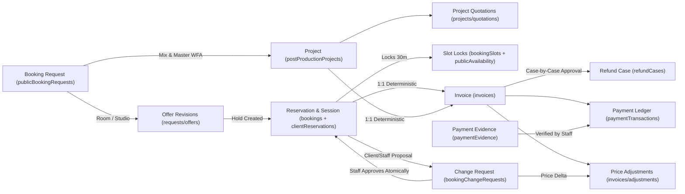

# BOOKING LIFECYCLE & RESERVATION ENGINE SPECIFICATION (PHASE 0 ARCHITECTURE FREEZE)

**Project:** 37 Music Studio (`37V2`)  
**Repository:** `https://github.com/jangangitungapah-pixel/37V2`  
**Target Branch:** `main`  
**Audited Baseline HEAD SHA:** `6ef8f0cab8f66a439309deb9b2a63488695a615a`  
**Phase:** Phase 0 — Business Logic Discovery & Architecture Freeze  
**Status:** Frozen Specification — **Phase 1 Entry Requires Owner Decisions (`OD-01`..`OD-14`)**  
**Date:** 25 November 2026  

> **Scope Notice:** This document is a pure Phase 0 architecture specification. Zero application code, Firestore Security Rules, Firestore indexes, dependencies, or environment configurations were modified in Phase 0. Unresolved policy choices are explicitly marked `PENDING OWNER APPROVAL`.

---

## 1. Audited System Baseline & Discrepancy Register

### 1.1 Audited Architecture Stack & Scale
- **Frontend:** React `19.3.1`, Vite `8.3.8`, JavaScript / JSX, Tailwind CSS `4.3.5`, Base UI `1.9.0`, React Hook Form `7.92.0`, Zod `4.6.7`, TanStack Query `5.107.1`, Zustand `5.1.0`, `date-fns` `4.4.0` + `@date-fns/tz` `1.5.0`.
- **Firebase Spark Plan (`studio37classic` / hosting site `studio37-os`):**
  - Firebase Authentication (Email/Password for Staff/Owner and Email/Password + Google OAuth for Client Portal).
  - Cloud Firestore (`firestore.rules`: **4,122 lines**, **167,726 bytes** = 64.0% of the hard 256 KB source cap, **38 collection/subcollection `match` blocks**, **159 helper functions**; `firestore.indexes.json`: **2 composite indexes** on `galleryItems` and `customerReviews`).
  - Optional Firebase App Check (`ReCaptchaV3Provider`).
- **External Approved Integration:** Direct browser unsigned image uploads to Cloudinary (`api.cloudinary.com/v1_1/{cloudName}/image/upload`) using dedicated preset `VITE_CLOUDINARY_PAYMENT_UPLOAD_PRESET` (`payment-evidence`) and WhatsApp Click-to-Chat (`https://wa.me/...`) links.
- **Confirmed Absent (Spark-Only):** Zero Cloud Functions, zero Cloudflare Workers, zero Firebase Storage, zero Cloud Billing, zero background cron runners, zero paid payment gateways.

### 1.2 Verification of Four Known Architectural Discrepancies (Source-Verified)

| # | Known PRD Discrepancy | Exact Code & Rules Evidence Found on `main` (`6ef8f0c`) | Operational / Security Consequence |
|---|---|---|---|
| **DISC-01** | **`ClientPaymentEvidenceForm` permits `cash` selection despite `Cash: staff` policy** | • UI: [ClientPaymentEvidenceForm.jsx](file:///c:/Users/hazel/source/repos/37V2/src/features/client-portal/billing/components/ClientPaymentEvidenceForm.jsx#L201-L219) iterates `SUPPORTED_PAYMENT_METHODS` (`['cash', 'transfer', 'qris', 'other']` from [invoice-status.js](file:///c:/Users/hazel/source/repos/37V2/src/features/admin/payment/utils/invoice-status.js#L37)). • Schema: [payment-evidence-schema.js](file:///c:/Users/hazel/source/repos/37V2/src/features/payment-evidence/schemas/payment-evidence-schema.js#L48) validates `paymentMethod: z.enum(SUPPORTED_PAYMENT_METHODS)`. • Rules: `isValidPaymentEvidenceBase()` in [firestore.rules](file:///c:/Users/hazel/source/repos/37V2/firestore.rules#L1048) accepts `'cash'` for `evidenceSource == 'client_portal'`. | Violates `Cash: staff`. Allows a Client to submit a self-declared Cash payment claim, and actually became an unintended workaround for Client Portal bookings paying Cash at the studio due to `DISC-02`. |
| **DISC-02** | **Generic Admin manual payment is hard-blocked on Client Portal invoices (`clientPaymentEvidenceRequired: true`), blocking Staff Cash recording** | • Creation flag: `createBooking()` in [calendar-booking-service.js](file:///c:/Users/hazel/source/repos/37V2/src/features/admin/calendar/services/calendar-booking-service.js#L636-L661) sets `clientPaymentEvidenceRequired = true` whenever `existingBookingRequest.source === 'client_portal'` and rejects `initialPaidInt > 0` (`booking/client-evidence-required`). • Service: `applyValidatedPaymentInTransaction()` in [payment-service.js](file:///c:/Users/hazel/source/repos/37V2/src/features/admin/payment/services/payment-service.js#L128-L133) throws `'payment/client-evidence-required'` unless `allowClientEvidenceInvoice === true`; `recordInvoicePayment()` (:321) hardcodes `allowClientEvidenceInvoice: false`. • UI: `InvoiceDirectoryTable.jsx` (:116) & `InvoiceDetailDrawer.jsx` (:98) disable/hide manual `Bayar` / `Catat Pembayaran`. • Rules: `isInvoiceImmutableFieldsUnchanged()` (`firestore.rules:867`) freezes `clientPaymentEvidenceRequired`, and `isValidPaymentTxPolicyAfter()` (`firestore.rules:949-958`) forces ALL `payment` txs on those invoices to have `source == 'client_evidence_verified'`. | Prevents valid real-world mixed-method flows (e.g., Client pays DP via QRIS/Transfer through Client Portal, then arrives at studio and pays remaining balance in Cash at the desk). Currently Staff cannot record that Cash without abusing Client upload. |
| **DISC-03** | **Single `pending_review` restriction per invoice is UI-only** | • UI: [ClientPaymentEvidencePanel.jsx](file:///c:/Users/hazel/source/repos/37V2/src/features/client-portal/billing/components/ClientPaymentEvidencePanel.jsx#L46-L58) hides the form via `shouldRenderForm = isEligibleForUpload && !hasPendingSubmission`. • Service: `submitClientPaymentEvidence()` in [payment-evidence-service.js](file:///c:/Users/hazel/source/repos/37V2/src/features/payment-evidence/services/payment-evidence-service.js#L139) reads only `tx.getInvoice(cleanInvoiceId)` and writes a random `ev_<24hex>` ID. • Rules & Tests: `isValidClientEvidenceCreate()` (`firestore.rules:1085-1104`) has no counter/lock guard; [test-firestore-rules.mjs](file:///c:/Users/hazel/source/repos/37V2/scripts/test-firestore-rules.mjs#L4650-L4669) explicitly passes multiple concurrent `pending_review` docs on the same invoice. | Two browser tabs or concurrent submissions bypass the UI lock. Also blocks legitimate scenarios if the Owner wants multiple installments submitted back-to-back before desk verification. |
| **DISC-04** | **Booking conversion immediately locks slots & confirms booking/request BEFORE deposit verification** | • `createBooking()` ([calendar-booking-service.js](file:///c:/Users/hazel/source/repos/37V2/src/features/admin/calendar/services/calendar-booking-service.js#L587-L771)) sets `bookings.sessionStatus = 'upcoming'`, writes deterministic `bookingSlots/{date}__{studioId}__{slotStartMinute}`, publishes `publicAvailability/{bookingId}`, issues `invoices/inv_{bookingId}` (`amountPaid: 0` for Client Portal), and marks `publicBookingRequests.status = 'confirmed'` (terminal) in one step — zero deposit verification check. | `bookings` has no `deposit_hold` / `reservationStatus`. An unpaid request immediately looks identically `"Confirmed"` on Calendar & Client Portal, with no formal hold deadline or expiry tracking. |

### 1.3 Newly Discovered Architectural Defects & Doc-vs-Code Contradictions

1. **CRITICAL IDENTITY DEADLOCK (`DISC-05`) — Isolated Client Portal Accounts (`client_{uid}`) Cannot View or Pay Invoices:**
   - All Email/Password sign-ups (`client-auth-service.js:114-115, 271`) and any Google sign-in whose email does not match an active unclaimed `customerEmailIndex` receive an isolated profile `customerId = "client_{uid}"` (`clientAccounts/{uid}.customerId`).
   - Meanwhile, `createBooking()` ([calendar-booking-service.js](file:///c:/Users/hazel/source/repos/37V2/src/features/admin/calendar/services/calendar-booking-service.js#L235-L447)) **completely ignores `existingBookingRequest.customerId`** and resolves `resolvedCustomerId` solely by phone via `customerPhoneIndex/{phoneHash}` -> creating/reusing `customers/cust_{uuid}`.
   - The resulting `invoices/inv_{bookingId}` gets `customerId = "cust_..."` AND `clientPaymentEvidenceRequired = true`.
   - **Deadlock:** Client Portal reads `invoices` and creates `paymentEvidence` strictly via `isClientOwnerOfCustomer(data.customerId)` (`firestore.rules:87-105`), which requires `clientAccounts/{uid}.customerId == data.customerId`. Because `"client_{uid}" != "cust_..."`, the Client **cannot see the invoice or upload proof**, AND Staff **cannot record manual payment** due to `clientPaymentEvidenceRequired: true`. Even worse, `clientCustomerLinks` has `allow update: if false`, and no Admin re-linking workflow exists.

2. **Stale Client Portal Booking Projections (`DISC-06`):**
   - `bookings` is strictly Staff-only (`firestore.rules:2186`). `/portal/bookings` (`useClientBookings.js`) queries `publicBookingRequests` only and renders `confirmedBookingSnapshot` compared against local browser time.
   - `bookings` lacks a back-pointer to `bookingRequestId`, and `confirmed` on `publicBookingRequests` is terminal. Therefore, any reschedule, room swap, cancellation, or no-show executed in Admin Calendar **never updates `publicBookingRequests.confirmedBookingSnapshot`**, leaving clients viewing stale times or cancelled sessions as `"Confirmed"`/`"Completed"`. Walk-in/phone bookings for `linked_customer` accounts also never appear in `/portal/bookings`.

3. **Silent Price Overwrite vs Immutable Invoice Drift (`DISC-07`):**
   - When Staff edits service/package/duration in `updateOrRescheduleBooking()` with `applyUpdatedPricing: true`, `bookings` totals and `commissionSnapshot` are overwritten in place (`calendar-booking-service.js:982-1052`), `bookingEvents` omits price deltas, and `invoices/inv_{bookingId}` (`financialSnapshot`) is immutable (`firestore.rules:863`) and 1:1 per booking. This creates an unresolvable `isSnapshotMismatch` warning (`BookingDetailDrawer.jsx:396-402`), even though `BookingDetailDrawer` tells Staff to adjust billing in Payment & Bill where no adjustment tool exists.

4. **Missing Refund Lifecycle, Stuck Invoice `draft`, & Uncoupled Cancellation (`DISC-08`):**
   - Only entry-correction `reversal` (`pay_rev_{txId}`) exists; no Refund entity/case exists.
   - `cancelBooking()` and `mark_no_show` do not resolve open invoices (`amountPaid > 0` or unpaid `balanceDue`).
   - `firestore.rules:2277` allows creating `invoices` in `draft`, yet `invoices.update` rules (`firestore.rules:883,895,908`) require `resData.invoiceStatus == 'issued'` — rendering `draft` permanently un-issuable and un-voidable.
   - `voidInvoice` does not check or reject existing `pending_review` `paymentEvidence`.

5. **Mix & Master (`post_production_inquiry`) Ends at Inquiry + UI Filter Bug (`DISC-09`):**
   - WFA inquiries (`mixing`, `mastering`, `mix-master`) are hard-blocked from creating `bookings`, `bookingSlots`, or `invoices` (`calendar-booking-service.js:204-209, 293-298`, `firestore.rules:388,555,778,2283,3224`) and currently have zero Project/Quotation/Milestone/Billing lifecycle.
   - In `/admin/booking-requests`, `BookingRequestToolbar.jsx:229-233` filters `publicServiceId` against `['rehearsal', 'recording', 'mix-master']`, missing Client Portal `'mixing'` and `'mastering'` IDs.

6. **Cross-Module Security Rules, Transaction Budget & Implementation Bugs (`DISC-10`):**
   - **20-call batch/transaction ceiling exceeded cleanly in 3 existing admin batch services:** `postCommissionBatch()` exceeds 20 doc lookups at `K >= 16` bookings (despite `MAX = 100`); `importLegacyBookingHistory()` exceeds at `> 18` distinct customers; `importLegacyBookingInvoices()` exceeds at `>= 7` paid bookings. Also `subscribeClientPaymentTransactions()` hits the 10-call single-query limit if `> 7` invoice IDs are queried in one `in` chunk.
   - **Rule budget & inconsistencies:** `bookings.update` consumes ~300–450+ CEL expressions (near 1,000 limit) and omits monotonic `version == resData.version + 1` in `isValidBookingStandardUpdate()`; `isBookingLifecycleOnlyUpdate()` does not block invalid session transitions (e.g., `cancelled -> upcoming`); `bookingSlots` checks `sessionStatus != 'cancelled'` (leaving slots if `no_show` rules weren't deleted atomically) while `publicAvailability` checks `!(sessionStatus in ['cancelled', 'no_show'])`; `payment-evidence-config.js:84` permits `secureUrlMax: 600` while `firestore.rules:1013` caps at `500`; `customerReviews.create` and `reviewInvitations.update` require `request.auth == null` (403 for logged-in Client Portal users!).
   - **Timezone / Formatting / UI / Reset / Dashboard Bugs:** `src/lib/booking-date.js` uses browser local timezone instead of `Asia/Jakarta`; `ClientBookingStepSchedule.jsx:91,104` & `ClientBookingStepReview.jsx:44` pass `durationMinutes` as `endMinute` to `formatMinuteRange()`; `PaymentEvidenceReviewDrawer.jsx:120-128` drops `notes` and omits `expectedEvidenceVersion`; Admin evidence labels pass `'id'` string instead of `{ locale: 'id' }`; `FACTORY_RESET_DELETION_MANIFEST` omits `customerEmailIndex`, `clientCustomerLinks`, and `clientProfiles` (leaving dangling client links after wipe) while `firestore.rules:201,203` caps manifest arrays at `<= 25` (21 used); `useDashboardData.js:345` destructures `{ entries }` instead of `{ payables }` (always yielding `ownerPayables = []`); `dashboard-calculations.js:630` links `?tab=settlement` instead of `?tab=cash-settlement`.

### 1.4 Documentation-vs-Code Drift Summary
The audit verified substantial drift between existing `docs/architecture/*.md` and live `main`:
- `FIREBASE-AUTH-FIRESTORE.md` & `CLIENT-PORTAL-PHASE-1-AUTH.md` & `CLIENT-BILLING-AND-PAYMENTS.md`: Claim Client Auth is Google-only verified email (`firestore.rules` still described in old snapshots as 1 collection or Google-only), whereas `main` ships Email/Password self-signup without email verification (`hasEligibleClientAuth`), `clientAccounts`, `clientCustomerLinks`, `clientProfiles`, and `customerEmailIndex`.
- `PRICE-AND-FEE-CATALOG-V2.md` & `ADMIN-PRICE-AND-FEE-SETTINGS.md`: Doc cites `Math.round((rate * min)/60)` instead of live `Math.ceil(min/60) * rate`; states `fixed_shift` never extends; cites wrong slot separator (`_` instead of `__`) and wrong error code; `ADMIN-PRICE-AND-FEE-SETTINGS.md` documents deleted V1 schema and claims `isActiveStaff()` writes `settings/pricing` (actual rule: `isActiveOwner()`).
- `PUBLIC-AVAILABILITY-CALENDAR.md` & `PUBLIC-BOOKING-REQUEST-WORKFLOW.md` & `CLIENT-BOOKING-AND-SESSION-WORKFLOW.md`: Claim landing form is demo-only without Firestore writes (false: real public writes to `publicBookingRequests`), state 26 half-hour rows / 10:00-22:00 hours (actual: 13 hourly `/availability` & Client Portal slots spanning 10:00–23:00 WIB, 25 landing half-hour starts), omit 38-key Client Portal requests, omit `useOwnerPublicPricingAutoSync`, and omit Factory Reset delete permissions.
- `FACTORY-RESET-AND-DANGER-AREA.md`, `ADMIN-BOOKKEEPING-MANAGEMENT.md`, `COMMISSION-AND-FEE-MANAGEMENT.md`, `CUSTOMER-MANAGEMENT.md`, `PAYMENT-EVIDENCE-AND-VERIFICATION.md`, `PAYMENT-AND-BILL.md`, `ADMIN-DASHBOARD-COMMAND-CENTER.md`, `ADMIN-SETTINGS-CENTER.md`: Various drifts on delete rules (`canFactoryResetDelete()`), query limits (`150` vs `100`), upload state `'selected'` vs `'ready'`, privacy notice text, 11-item Admin sidebar vs 8, and missing `publicBookingRequests` subscription in Dashboard docs.

---

## 2. Eight Approved Business Decisions (Immutable Architectural Baseline)

These 8 decisions are locked by Owner approval and govern every domain, state transition, data contract, and security rule in this specification:

| Code | Domain | Decision Token | Mandatory Architectural Meaning & Enforced Rule |
|---|---|---|---|
| `AD-01` | **Reservation model** | `deposit_hold` | Creating a reservation awaiting deposit creates a slot-protected `deposit_hold` booking (locking `bookingSlots` + blocking `publicAvailability`), strictly distinct from `confirmed` reservation state. |
| `AD-02` | **Deposit policy** | `configurable` | Supports `none` (No Deposit), `fixed` (Fixed Amount IDR), and `percentage` (Integer % of subtotal/total, with IDR rounding rule), configured with a studio default plus overrides per Service Type / Service Option in `settings/bookingPolicies`. An accepted Offer / Reservation snapshots its policy permanently; global setting updates NEVER mutate historical accepted offers, bookings, or invoices. |
| `AD-03` | **Cash policy** | `staff` | Clients NEVER declare Cash as paid or upload Cash "proof" in Client Portal. Only authenticated Staff/Owner record Cash transactions directly in Firestore with `recordedByUid`, timestamp, and audit metadata. |
| `AD-04` | **Refund policy** | `case_by_case` | Zero automatic refunds on cancellation, hold expiry, or price reduction. Every refund requires a formal `refundCases` record, explicit Staff/Owner review decision, written reason, and settlement/credit choice. Actual physical money return or credit issuance (`Refund`) is strictly separate from entry-error ledger correction (`Payment Reversal`). |
| `AD-05` | **Hold expiry** | `manual_expiry` | Zero server-side cron or automated Cloud Function expiration (Spark-only). Staff/Owner manually execute Hold Expiry (`expired`) & slot release. The UI surfaces overdue holds prominently in Admin Calendar, Booking Requests, and Dashboard so active holds past deadline are never forgotten. |
| `AD-06` | **Pricing changes** | `adjustment` | Never silently overwrite accepted Offer snapshots or Invoice `financialSnapshot`. Any post-offer price delta requires an append-only Adjustment record (`invoices/{invoiceId}/adjustments/{adjId}`) recording reason, signed IDR amount, actor/approver, and timestamp. Commission snapshot changes remain isolated and auditable. |
| `AD-07` | **Client changes** | `approval` | Clients submit structured change requests (`bookingChangeRequests`) for reschedule, room swap, duration change, service change, or cancellation inquiry. Client writes NEVER mutate `bookings`, `bookingSlots`, or `invoices`; Staff/Owner must approve/apply atomically. |
| `AD-08` | **Mix & Master** | `project` | Post-production / WFA work runs under a dedicated `postProductionProjects` lifecycle (Inquiry -> Quotation -> Client Approval -> Deposit/Milestones -> Production/Client Materials -> Revisions -> Additional Scope -> Delivery -> Completion / Cancellation & Refund). It NEVER creates `bookings`, `bookingSlots`, or `publicAvailability` room locks. |

---

## 3. Domain Architecture & Collection Topology (9 Domains)

Per Executive Mandate ("avoid unnecessary new collections, duplicated state, and duplicated business logic"), the 9 domains map onto **minimal Firestore structures** preserving backward compatibility with existing collections:

| # | Domain | Storage Strategy | Justification |
|---|---|---|---|
| **1** | **Booking Request** | **Reuse** `publicBookingRequests/{requestId}` (+ `/communications`, `/activities`) | Already handles landing page (33-key), availability calendar, and Client Portal (38-key) submissions cleanly with public create rules. Extend with links (`activeOfferId`, `projectId`) instead of creating a new request collection. |
| **2** | **Offer** | **Subcollection** `publicBookingRequests/{requestId}/offers/{offerId}` + `activeOfferSummary` cache on `publicBookingRequests` | An offer revision belongs 1:1 to a Booking Request. Storing immutable Offer revisions as a subcollection preserves full negotiation history (`OFFER-1`, `OFFER-2`, ...) without creating another top-level collection or indexing bloat. |
| **3** | **Reservation** | **Extend** `bookings/{bookingId}` + **Reuse** `bookingSlots/{slotId}` & `publicAvailability/{bookingId}` + **Add** `clientReservations/{bookingId}` | Keep `bookings` as canonical Staff source of truth (extended with `reservationStatus`, `depositPolicySnapshot`, `holdPolicy`, `sourceRequestId`, `acceptedOfferId`, `clientUid`) and keep 30-min `bookingSlots` + `publicAvailability` intact. Add ONE lean client-safe projection `clientReservations/{bookingId}` (omitting internal `commissionSnapshot`, staff `notes`, phone hashes) synced atomically with `bookings` so clients always see real-time schedule/hold/cancel updates AND walk-in bookings linked to their account (`DISC-06`) without exposing internal Staff data. |
| **4** | **Payment** | **Extend** `invoices/{invoiceId}` + **Subcollection** `invoices/{invoiceId}/adjustments/{adjId}` + **Reuse** `paymentTransactions/{txId}` | Preserve 1 deterministic invoice per booking (`inv_{bookingId}`) or project (`inv_prj_{projectId}`). Immutable `financialSnapshot` + append-only `adjustments/` subcollection computes live `effectiveTotalAmount` and `balanceDue` without silent overwrite (`AD-06`). Append-only `paymentTransactions` already supports multi-method payments; add `recordedChannel` / `bookingType` to distinguish Staff Cash safely (`AD-03`). |
| **5** | **Payment Evidence** | **Reuse** `paymentEvidence/{evidenceId}` (+ optional deterministic lock doc if `OD-05 = one_pending`) | Already cleanly modeled for `client_portal` (`pending_review` -> `verified` \| `rejected`) and `admin_manual` (`attached`). Fix rules/UI/Zod to forbid `'cash'` on `client_portal` (`AD-03`), align `secureUrl` limits (`<= 500`), and support installment submissions cleanly. |
| **6** | **Session** | **Separate fields on** `bookings/{bookingId}` + `clientReservations/{bookingId}` + **Reuse** `bookingEvents/{eventId}` | Session execution (`pending_confirmation -> upcoming -> in_progress -> completed \| no_show \| cancelled`, timestamps `checkedInAt`, `actualStartedAt`, `actualCompletedAt`) shares 1:1 cardinality with a room reservation and is directly required by Commission & Customer Reviews (`commissionCalculation` & `reviewInvitations` query `bookings` by `actualCompletedAt`). Separating `reservationStatus` from `sessionStatus` eliminates conflation without splitting `bookings`. |
| **7** | **Change Request** | **New Top-Level Collection** `bookingChangeRequests/{changeRequestId}` | Client/Admin change requests require Admin queue filtering (`status == 'pending_review'`) across all bookings as well as Client listing across all their bookings. A top-level collection avoids slow collection-group index dependencies and cleanly decouples Client write rules from canonical `bookings` (`AD-07`). |
| **8** | **Refund** | **New Top-Level Collection** `refundCases/{refundId}` | Refund workflows span Bookings, Mix & Master Projects, cancelled holds, and overpayment/price-reduction credits (`AD-04`), requiring Owner/Staff cross-studio financial queue visibility (`pending`, `approved`, `settled`) for Pembukuan & audit trails. Distinct from `paymentTransactions` `reversal`. |
| **9** | **Mix & Master Project** | **New Top-Level Collection** `postProductionProjects/{projectId}` + `/quotations/{quotationId}` + `/activities/{activityId}` | Projects have no rooms, no 30-min `bookingSlots`, different lifecycle stages (materials, production, revisions, delivery, milestones), and independent invoices (`inv_prj_{projectId}`). Top-level collection guarantees zero contamination of room availability queries or `bookingSlots` (`AD-08`). |
| **Cfg** | **Booking Policies** | **New Singleton** `settings/bookingPolicies` (+ public deposit rule projection in `publicPricingCatalog/current`) | Mirrors `settings/pricing` -> `publicPricingCatalog/current` pattern for configurable deposit policies (`AD-02`), default hold deadlines, balance deadlines, and cutoff policies while hiding internal staff-only settings. |

---

## 4. End-to-End Workflows & Business Rules

### 4.1 Studio Booking Request -> Offer -> Deposit Hold -> Reservation Confirmation
1. **Request Intake (`publicBookingRequests`):** Client submits via Landing Page, Availability Calendar, or Client Portal (`/portal/book`). Status starts `new`. No slot is locked. Anonymous requests are optionally linkable upon Staff contact or account matching.
2. **Admin Review & Availability Check:** Staff transitions `new -> in_review` (or `awaiting_customer` via WhatsApp inquiry), checks live Calendar (`bookings` / `bookingSlots` + overdue holds notice). If requested room `'any'` or unavailable slot, Staff proposes room/time alternatives in an Offer.
3. **Structured Offer Creation (`publicBookingRequests/{requestId}/offers/{offerId}`):**
   - Staff selects exact schedule (date, room `room-a | room-b`, 30-min aligned start/end `600..1380`), service type & option, price snapshot (from catalog V2 or manual quote), **resolved Deposit Policy snapshot** (from `settings/bookingPolicies` global default or service/option override: `none | fixed | percentage`, computed `minimumDepositAmount`), and payment/hold deadlines (`holdExpiresAt`, `balanceDueDate`/`balanceDuePolicy`).
   - **Two Offer Modes (preserving Spark-only Security Rules so Clients NEVER lock slots directly):**
     - **Quote-Only Offer (`quoteOnly` / no immediate hold):** Offer sits in `sent`; Client clicks Accept (`accepted`) -> Staff reviews & creates Deposit Hold / Reservation; OR
     - **Staff-Backed Deposit Hold Offer (`deposit_hold_offer`, Recommended):** Staff verifies slot availability while issuing the Offer, atomically creating: `offers/{offerId}` (`status: 'sent'`), `bookings/{bookingId}` (`reservationStatus: 'deposit_hold'`, `sessionStatus: 'pending_confirmation'`), `bookingSlots` (30-min locks protecting the slot while the client reviews/pays within the hold window), `publicAvailability/{bookingId}`, `clientReservations/{bookingId}`, and optionally issuing `invoices/inv_{bookingId}` only upon Client acceptance (or immediately upon hold — governed by `OD-01`/`OD-04` and **Never** allowing Clients to write `bookings` or `bookingSlots` directly in Firestore Rules).
   - **Immutability:** Once `offer.status` becomes `'accepted'`, all price, schedule snapshot, and deposit rule fields on that Offer are permanently frozen (`AD-02`, `AD-06`). Updating `settings/pricing` or `settings/bookingPolicies` later NEVER alters this Offer, Reservation, or Invoice.
4. **Offer Revision:** If Client requests an adjustment or rejects (`rejected`) and negotiates, Staff creates a new revision `offer_{rev+1}` (either superseding prior open offers automatically per `OD-13` Option A or requiring explicit withdrawal per `OD-13` Option B).

### 4.2 Direct Walk-In / Phone Booking (Admin Calendar)
- Staff creates Reservation directly in Admin Calendar without a `publicBookingRequests` doc (`source: 'admin_direct'`).
- Evaluates resolved Deposit Policy (`settings/bookingPolicies`):
  - If Cash/Transfer/QRIS DP >= `minimumDepositAmount` (or full payment) is received on the spot -> creates `bookings` directly as `reservationStatus: 'confirmed'`, `sessionStatus: 'upcoming'`, `invoices/inv_{bookingId}`, initial `paymentTransactions/pay_initial_{bookingId}`, optional Admin `paymentEvidence` (`status: 'attached'`), and `clientReservations/{bookingId}` (if `clientUid` linked).
  - If created **without** meeting minimum deposit (phone promise to transfer DP later) -> creates `bookings` as `reservationStatus: 'deposit_hold'`, `sessionStatus: 'pending_confirmation'`, locks `bookingSlots`, sets `holdExpiresAt`, and surfaces overdue countdown until DP is recorded or hold is manually expired.

### 4.3 Deposit Confirmation Gate & No-Deposit Path
- **Fundamental Separation:** `reservationStatus: 'deposit_hold'` **protects room slots** via `bookingSlots`, while `sessionStatus` stays `'pending_confirmation'` (NOT `'upcoming'`) until reservation confirmation criteria are satisfied (`AD-01`). Sessions CANNOT be checked in or started (`in_progress`) while `reservationStatus === 'deposit_hold'`.
- **Verified Balance Metric:** Deposit fulfillment compares **verified net paid amount** (`verifiedPaidAmount = SUM(paymentTransactions where type == 'payment') - SUM(reversed)` adjusted for non-reversed payments; unverified `pending_review` `paymentEvidence` does **NOT** count as paid!).
- **Confirmation Gate Formula (`depositRequired = depositPolicySnapshot.minimumDepositAmount`):**
  - When `depositType !== 'none'`: `verifiedPaidAmount >= minimumDepositAmount` (including full payment `verifiedPaidAmount === effectiveTotalAmount`) fulfills deposit requirement (`depositStatus: 'met'`), enabling transition `deposit_hold -> confirmed` (and `sessionStatus: pending_confirmation -> upcoming`) per **Owner Decision `OD-01`**.
  - When `depositType === 'none'` (`No Deposit` policy): `minimumDepositAmount = 0`, `depositStatus = 'not_required'`, following **Owner Decision `OD-04`** (auto-confirm on Offer Acceptance OR explicit Staff confirmation).
  - Partial DP (`0 < verifiedPaidAmount < minimumDepositAmount`): keeps reservation in `deposit_hold` with `depositStatus: 'partial_below_minimum'` subject to **Owner Decision `OD-07`**.

### 4.4 Hold Management & A hold TTL is configurable per studio/service/option. An absent/null default TTL means the policy is not configured: creating a deposit hold must fail closed with an actionable Owner-facing error. No cron or scheduled expiry is allowed.

Manual Expiry (`AD-05` — Spark-Only)
- Because Cloud Functions / cron jobs are forbidden, **no booking expires automatically in the background**.
- **Clock Display (`Asia/Jakarta`):** Every `deposit_hold` stores `holdExpiresAt` (Timestamp) determined by **Owner Decision `OD-02`**. UI renders live countdown (`Held until ... WIB`) and highlights **`OVERDUE HOLD`** when `now > holdExpiresAt && reservationStatus === 'deposit_hold'`.
- **Pending Evidence Shield (`OD-09`):** If an invoice for a `deposit_hold` has `hasPendingEvidence` (`pending_review` proof submitted before or around the deadline), Admin UI warns Staff (`"Client submitted payment proof awaiting review"`) and blocks accidental one-click Hold Expiry unless Staff explicitly reviews/rejects the pending proof or enters an Owner override confirmation.
- **Manual Expiry (`expireReservationHold()`):** Staff/Owner explicitly executes expiry with actor UID and reason:
  - Atomically updates `bookings`: `reservationStatus: 'deposit_hold' -> 'expired'`, `sessionStatus: 'pending_confirmation' -> 'cancelled'`.
  - Atomically deletes all `bookingSlots` & `publicAvailability/{bookingId}` (freeing the room immediately for reacquisition!).
  - Updates `clientReservations/{bookingId}`.
  - Handles invoice & partial payments: if `amountPaid === 0`, voids `invoices/inv_{bookingId}` (`voidReason: 'Reservation hold expired without payment'`). If partial `amountPaid > 0` exists, voids/marks cancellation credit and opens/links a `refundCases` evaluation (`AD-04` — NEVER auto-forfeited or auto-refunded without decision).
- **Manual Hold Extension:** Staff/Owner (or Client request + Staff approval per `OD-08`) extends `holdExpiresAt` and logs extension reason & actor in `bookingEvents`.

### 4.5 Multi-Method Payment & Staff Cash Policy (`AD-03`)
Resolves **all conflicts** between mandatory client proof (`DISC-01`, `DISC-02`, `DISC-03`) and real studio operations:
1. **Strict Client Portal Method Restriction (`AD-03`):**
   - `paymentEvidence` submissions where `evidenceSource === 'client_portal'` **ONLY permit non-cash methods**: `['transfer', 'qris']` (plus optionally `'other'` for e-wallet/bank variations, explicitly **EXCLUDING `'cash'`** at UI, Zod, service, and `firestore.rules`!).
   - Clients wishing to pay Cash see clear instructions on `/portal/invoices`: *"Pay Cash directly at Studio Desk (Staff will record your receipt immediately)."*
2. **Dual-Channel Recording on ALL Issued Invoices (Fixing `DISC-02`):**
   - Replace the blunt boolean `clientPaymentEvidenceRequired` lock with granular **Evidence Policy Rules**:
     - `client_evidence_verified` (Client uploads QRIS/Transfer proof -> Staff verifies atomically -> `paymentTransactions/pay_evidence_{evId}`).
     - `staff_cash` (**Always permitted** by active Staff/Owner on **ANY issued invoice**, including Client Portal invoices! Never blocked by mandatory online proof policy, because Staff physical possession is the verification for Cash, recorded with `paymentMethod: 'cash'`, `source: 'staff_cash_desk'`, `recordedByUid`, optional notes).
     - `staff_manual_non_cash` (Transfer/QRIS/Other recorded by Admin on Admin-managed invoices, or exception/fallback on Client Portal invoices governed by **Owner Decision `OD-06`**).
3. **True Independent Multi-Method Installments:**
   - Example: Invoice Rp 600.000 -> `pay_evidence_ev1` (`transfer`, Rp 180.000) + `pay_evidence_ev2` (`qris`, Rp 220.000) + `pay_cash_uuid` (`cash`, Rp 200.000) = `amountPaid: 600.000`, `balanceDue: 0`, `paymentStatus: 'paid'`.
   - Every transaction keeps its original `id`, `paymentMethod`, `amount`, `source`, `receivedAt`, `referenceNumber`, `evidenceId` (nullable), and `recordedByUid`. No prior transaction's method or amount is ever overwritten.
4. **Overpayment & Mismatch Protection:**
   - Every payment transaction checks `amount <= invoice.balanceDue` inside the Firestore transaction against the latest committed `invoice` doc.
   - If a client claims Rp 300.000 on a transfer screenshot that actually transferred Rp 200.000 (`evidence mismatch`), Staff sets `verifiedAmount: 200000` (with mismatch audit note), creating the transaction strictly for **Rp 200.000** (`balanceDue` reflects remaining balance).
   - If Client uploads a transfer screenshot AFTER another verification reduced `balanceDue` below `claimedAmount`, verification caps or rejects overpayment (`verifiedAmount <= balanceDue`), routing excess to manual review or credit/refund (`OD-11`/`OD-12`).
5. **Concurrent / Multiple Pending Evidence (`OD-05`):** Evaluated in Section 9 (`OD-05`): supports either single-pending enforcement backed by an invoice lock field (`hasPendingEvidence` / `pendingEvidenceId`) OR multiple concurrent submissions protected by transactional `amount <= balanceDue` checks and duplicate-asset fingerprint warning (`cloudinaryPublicId` / hash + `referenceNumber`).

### 4.6 Change Management & Pricing Adjustment Workflow (`AD-06`, `AD-07`)
1. **No Silent Overwrites:** Accepted `offers` and `invoices.financialSnapshot` remain **100% immutable forever**.
2. **Client-Initiated Change (`AD-07`):**
   - Client creates `bookingChangeRequests/{chgId}` (`status: 'pending_review'`) specifying requested type (`reschedule | change_room | change_duration | change_service | request_cancellation`), target parameters, and client reason. Canonical `bookings`, `bookingSlots`, and `invoices` are **UNTOUCHED**.
   - Staff inspects live availability & fee impact:
     - **Direct Approve & Apply:** If schedule/scope matches and pricing is agreed (or Rp 0 delta), Staff atomically executes change -> replaces `bookingSlots`, updates `bookings` + `publicAvailability` + `clientReservations`, appends adjustment to `invoices/{id}/adjustments/{adjId}` if price changed, appends `bookingEvents`, marks change request `approved_applied`.
     - **Counter-Proposal / Re-Price:** Staff attaches `proposedPricingDelta` & `proposedSchedule` -> sets change request `awaiting_client_approval` -> Client approves (`client_approved`) -> Staff applies atomically (or Client rejects -> no booking mutation).
     - **Decline:** Staff sets `rejected` with `reviewReason`. Original reservation & slots remain intact.
3. **Admin-Initiated Edit / Extension (Walk-In / Phone / Live Session Extension):**
   - Staff initiates Edit / Extend Duration in Admin Calendar (`expectedVersion` optimistic concurrency check):
     - Re-validates union of old & new 30-min `bookingSlots` atomically (`oldSlots \ newSlots` deleted, `newSlots \ oldSlots` created).
     - If service/duration price changes: writes an append-only `invoices/{invoiceId}/adjustments/{adjId}` record (`deltaAmount > 0` surcharge or `< 0` reduction, `reason`, `category`, `actorUid`) rather than overwriting historical `financialSnapshot`!
     - Recomputes `invoice.adjustmentTotal`, `invoice.effectiveTotalAmount = financialSnapshot.totalAmount + adjustmentTotal`, `balanceDue = effectiveTotalAmount - netPaidAmount` (clamped with excess tracked as `creditBalance` or triggering `refundCases` per **Owner Decision `OD-11`**).
     - Live running session (`in_progress`) extension adds contiguous future 30-min `bookingSlots` immediately after checking zero collision with the next booking!

### 4.7 Exceptions, Cancellation, No-Show, Payment Reversal vs Refund (`AD-04`)
- **Explicit Accounting Distinction (CRITICAL):**
  - **Payment Reversal (`paymentTransactions` `transactionType: 'reversal'`, ID `pay_rev_{txId}`):** Used ONLY when a Staff member recorded a wrong entry (typo Rp 500.000 instead of Rp 50.000, wrong invoice, bounced transfer that never actually settled). Decrements `invoice.amountPaid` back to truthful collected receipts. **Never** represents sending real money back to a customer.
  - **Refund Case (`refundCases/{refundId}`):** Used ONLY when the studio genuinely received valid money (`paymentTransactions`) and agrees to return cash/transfer OR convert to studio credit following cancellation, studio fault/outage, double transfer, or downward price adjustment (`AD-04`).
- **Lifecycle of Cancellation (`Client Cancellation` vs `Studio Cancellation` vs `No-Show` vs `Late Arrival`):**
  - **Late Arrival:** Session remains `upcoming -> in_progress` once checked in; scheduled `endMinute` does NOT auto-extend (extending into a later free slot requires paid/approved Duration Extension Change Request).
  - **No-Show:** Allowed `15+` min after `startMinute` only when `!checkedInAt`. Sets `reservationStatus` (stays `confirmed` as forfeited reservation record or marked `no_show_forfeited`), `sessionStatus: 'no_show'`, atomically deletes `bookingSlots` & `publicAvailability`, updates `clientReservations`, retains financial liability (`invoice` not auto-voided; any deposit refund request is reviewed case-by-case via `refundCases`).
  - **Client / Studio Cancellation:** Atomically transitions `reservationStatus -> 'cancelled'`, `sessionStatus -> 'cancelled'`, releases all `bookingSlots` & `publicAvailability`, updates `clientReservations`:
    - If `netPaidAmount === 0`: Invoice atomically transitions `issued -> void` (`voidReason` recorded).
    - If `netPaidAmount > 0`: Invoice enters cancelled/settlement-pending resolution (`effectiveTotalAmount` adjusted via cancellation fee adjustment or voided with `refundCases` created in `under_review` / `requested` requiring Owner/Staff decision: `partial_refund | full_refund | credit_note | forfeited_no_refund`). Zero automatic refund!

### 4.8 Mix & Master Project Lifecycle (`AD-08`)
1. Client sends `post_production_inquiry` from Landing Page (`publicServiceId: 'mix-master'`) or Client Portal (`mixing | mastering`, with brief, project type, track count, target deadline). Zero room or slot selection.
2. Staff reviews inquiry in `/admin/booking-requests` and clicks **"Create Project"** -> atomically creates `postProductionProjects/{projectId}` (`status: 'draft_quotation'` or `'scoping'`), links `publicBookingRequests.projectId`, marks request `accepted`/`converted_to_project`. **Zero `bookings`, zero `bookingSlots`, zero `publicAvailability`.**
3. Staff issues **Quotation Revision** (`postProductionProjects/{projectId}/quotations/{qtId}`) defining tracks/scope, included revisions count (e.g. `2` rounds), target turnaround/deadline, total price, deposit rule, and optional **Payment Milestones** (`[{ milestoneId, label, percentageOrAmount, dueTrigger }]`, e.g. `50% DP + 50% Final Delivery`).
4. Client approves Quotation in Client Portal (`client_approved`) -> freezes Quotation snapshot -> atomically issues `invoices/inv_prj_{projectId}`.
5. Client submits DP (Transfer/QRIS proof -> Staff verifies) or Staff records Desk Cash -> Deposit met -> Project advances (`awaiting_materials` or `in_production`).
6. Material & Revision loop: `waiting_for_client_materials <-> in_production <-> delivery_review <-> revision_in_progress`.
7. **Additional Scope / Extra Revisions:** Staff creates a new `quotations` addendum + `invoices/inv_prj_{projectId}/adjustments/{adjId}` (requires Client acceptance before billing/work).
8. **Completion / Cancellation:** `delivered -> completed` after final milestone settlement; Cancellation releases no room slots (none exist) and evaluates paid deposits/milestones via `refundCases` (`case_by_case`).

### 4.9 Identity Reconciliation Workflow (Resolving `DISC-05`)
- **Problem:** Isolated Email/Password or unmatched Google clients (`customerId = "client_{uid}"`) do not have a CRM `customers/cust_...` record, causing booking conversion by phone to fork `cust_{uuid}` away from `client_{uid}`.
- **Target Design (No Silent Auto-Merge):**
  1. `publicBookingRequests` carries both `clientUid` and `customerId` (`client_{uid}` or `cust_...`).
  2. When converting a `client_portal` request in `createBooking()`:
     - Propagate `clientUid: existingBookingRequest.clientUid` onto BOTH `bookings/{bookingId}`, `clientReservations/{bookingId}`, and `invoices/inv_{bookingId}`!
     - If `client_{uid}` matches an existing `customers/cust_...` by verified email OR explicit Staff/Client identity linking, rebind `clientAccounts/{uid}.customerId`, `clientCustomerLinks`, and `clientProfiles` **with explicit actor audit** (`OD-14`); OR if kept isolated initially, Staff explicitly creates/promotes a canonical `customers/cust_{uuid}` linked 1:1 to `clientAccounts/{uid}` inside `createBooking()` so `client_{uid}` NEVER drifts from the invoice's `customerId`.
  3. Dual ownership enforcement (`isClientOwnerOfDoc(data)` checking `data.clientUid == uid || isClientOwnerOfCustomer(data.customerId)`) guarantees a Client Portal account ALWAYS sees bookings/invoices created from their portal account even before/during customer profile linking.

---

## 5. Transaction Architecture & Concurrency Summary

Every critical operation executes inside a single Firestore `runTransaction` obeying:
1. **Strict Reads-Before-Writes:** Every `tx.get(...)` executes before the first `tx.set/update/delete`.
2. **Firestore Security Rule Lookup Budget:** Every single write doc stays strictly `<= 10` unique doc lookups, and every multi-doc transaction stays strictly `<= 20` unique `(path, pre/post)` lookups (for 30-min slot loops over up to 26 slots, all `bookingSlots` read/verify the SAME `bookings/{bookingId}` doc, counting as **1 unique lookup**, not 26!).
3. **Optimistic Concurrency & Idempotency:** Pre-generated deterministic or client-held operation IDs (`bkg_`, `off_`, `ev_`, `pay_`, `pay_rev_`, `chg_`, `ref_`, `adj_`) + `expectedVersion` checks guarantee retries are idempotent and concurrent Staff edits fail loudly with stale-version errors rather than silently overwriting data.

Detailed read/write maps for all 11 transactions are defined in [BOOKING-LIFECYCLE-DATA-CONTRACTS.md](file:///c:/Users/hazel/source/repos/37V2/docs/architecture/BOOKING-LIFECYCLE-DATA-CONTRACTS.md).

---

## 6. Downstream Integration Boundaries

| Downstream Module | Verified Coupling & Phase 1+ Contract Impact |
|---|---|
| **Admin Calendar (`/admin/calendar`)** | Must visually differentiate `deposit_hold` (amber/hold badge, overdue indicator if `now > holdExpiresAt`) from `confirmed` bookings (`upcoming`/`in_progress`), display client pending evidence protection banner before manual hold expiry, and execute atomic slot replacement on change-request approval. |
| **Public Availability (`/availability`)** | Zero change to public 13-slot hourly grid (`10:00–23:00 WIB`). **Both** `deposit_hold` AND `confirmed` reservations publish `publicAvailability/{bookingId}` so held slots cannot be double-requested on the public site; manual `expired` / `cancelled` / `no_show` immediately deletes `publicAvailability/{bookingId}`. |
| **Payment & Bill (`/admin/payments`)** | Must read `effectiveTotalAmount = financialSnapshot.totalAmount + adjustmentTotal`, show Adjustment ledger & Refund cases separately from Payment Reversals, unlock Staff Cash (`staff_cash_desk`) on Client Portal invoices (`AD-03`), disallow `'cash'` from `paymentEvidence`, and pass `notes` + `expectedEvidenceVersion` in `PaymentEvidenceReviewDrawer` (fixing discovered UI bug). |
| **Client Portal (`/portal/*`)** | `/portal/bookings` reads live `clientReservations` (fixing `DISC-06` stale snapshot & invisible walk-ins). `/portal/book` uses `publicPricingCatalog/current` deposit policy preview (showing expected DP vs full amount honestly). `/portal/invoices` blocks `'cash'` in proof upload (`AD-03`), surfaces Hold deadline & Refund/Change request status, fixes `formatMinuteRange` argument bug (`ClientBookingStepSchedule.jsx:91,104`). |
| **Pembukuan / Bookkeeping (`/admin/pembukuan`)** | Continues reading `invoices` + `paymentTransactions` directly (zero duplicate `bookkeepingEntries` sync for customer bills). **Extension required in Phase 3/4:** Billed revenue reads `invoice.effectiveTotalAmount`; net collected cash must subtract `refundCases` (`status == 'settled'`) cash outflows cleanly from `paymentTransactions` cash inflows so settled refunds reduce net cash truthfully without masquerading as entry-error reversals! |
| **Commission & Fee (`/admin/commission`)** | **Zero dependency on reservation hold or payment status.** Commission eligibility MUST check `booking.sessionStatus === 'completed'` (never `'pending_confirmation'` / `'deposit_hold'`), preserving `actualCompletedAt` & `deliveryMode === 'studio'`. Fix `postCommissionBatch()` chunking (`<= 5` items/tx instead of `<= 100`) so Firestore's 20-call rule limit never trips. Mix & Master projects use separate project fee tracking in later phases and never enter studio-room `commissionBatches`. |
| **Customer Directory & Reviews** | `customers.bookingCount` should increment when Reservation becomes active/confirmed (or clearly separate `completedCount` vs `cancelledHoldCount`). Fix `customerReviews` / `reviewInvitations` rule requiring `request.auth == null` so signed-in Client Portal users can submit post-session reviews! |
| **Dashboard (`/admin`)** | Surface `Overdue Deposit Holds`, `Pending Payment Evidence`, and `Open Change Requests` in Needs Attention cards (no cron needed — evaluated client-side at Asia/Jakarta render time). Fix `subscribeActivePayables` destructuring (`{ payables }`) and `?tab=cash-settlement` URL bug. |
| **Settings & Factory Reset** | Add `settings/bookingPolicies` (`Owner` write, `Staff` read). Add `publicPricingCatalog/current` to `Preserved Assets`, expand `FACTORY_RESET_DELETION_MANIFEST` to cover Client Portal operational docs (`clientReservations`, `bookingChangeRequests`, `refundCases`, `postProductionProjects`, `customerEmailIndex`, `clientCustomerLinks`, `clientProfiles`), and raise the `<= 25` target cap in `firestore.rules:201,203` to `<= 40`. |

---

## 7. Dependency, Concurrency & Spark-Only Infrastructure Audit

- **No Paid Infra Added:** 100% compatible with Firebase Spark Free Plan.
  - Zero server timers / scheduled Functions (`AD-05`: `manual_expiry` + Admin UI real-time overdue badges computed against `Date.now()` in `Asia/Jakarta`).
  - Zero Firebase Storage (`paymentEvidence` uses existing unsigned Cloudinary `VITE_CLOUDINARY_PAYMENT_UPLOAD_PRESET`, keeping random `pe_<24hex>` filenames, strict `5 MB` cap, `jpg/jpeg/png/webp`, privacy notice, and reconciling `secureUrl <= 500` chars across client & Rules).
  - Zero WhatsApp Business API costs (`wa.me` manual templates retained).
- **Timezone Contract (`Asia/Jakarta` / UTC+7):**
  - Replace local-clock helpers in [booking-date.js](file:///c:/Users/hazel/source/repos/37V2/src/lib/booking-date.js) with `Asia/Jakarta` `@date-fns/tz` utilities so Indonesian calendar comparisons (`overdue`, `dueDate`, `bookingDate`, `15-min no-show`) never drift for clients/staff browsing outside WIB.
- **Firestore Scalability & Limits:**
  - Read queries stay bounded (`limit(100..300)`), using single-field or minimal composite indexes in `firestore.indexes.json`.
  - Keep `firestore.rules` cleanly factored below 256 KB source cap (currently 167.7 KB) and individual write rules well below 1,000 CEL expressions and `<= 10` / `<= 20` doc lookups.

---

## 8. Comprehensive Business Scenario Matrix (70 Scenarios)

*(Abbreviations: `C` = Client, `S` = Staff, `O` = Owner, `Sys` = Client SDK Transaction)*

### 8.1 Request & Offer (`SC-REQ`)

| Scenario ID | Actor | Initial State | Trigger | Business Rule | Financial Impact | Slot Impact | State Transition | Recovery | Audit |
|---|---|---|---|---|---|---|---|---|---|
| `SC-REQ-01` | C / S | No request; slots free | Client submits available slot request; Staff sends Offer | Checks live calendar; sends Offer v1 with price & Deposit Policy snapshot | None until Offer accepted (no invoice yet or draft quote) | None (`quote_only`) OR `bookingSlots` locked (`deposit_hold_offer`) | Req: `new->in_review->offer_sent`; Off: `sent` | Slot conflict check forces alternate proposal | `request_created`, `offer_created` + `actorUid` |
| `SC-REQ-02` | S | Multiple overlapping `new` requests for same slot | Staff reviews competing requests | Admin chooses 1 request to issue `deposit_hold_offer` (or holds slot); competing requests warned in UI | None on unaccepted competing requests | First accepted/held booking wins `bookingSlots` (`slot-conflict` blocks 2nd) | Winner Req `offer_sent`; Rival `awaiting_customer` or `declined` | Conflict error directs Staff to propose alternate room/time | `bookingEvents` + request `activities` |
| `SC-REQ-03` | S | Room A occupied, Room B free | Staff proposes Room B alternative in Offer | Offer snapshot sets `studioId: 'room-b'` and notes room substitution explicitly | Uses Room B / selected option price | Locks Room B only when hold created | Req: `offer_sent`; Off: `sent` | Client may reject -> revise to another slot | Offer snapshot stores exact `studioId` & reason |
| `SC-REQ-04` | C / S | Request has `requestedRoomId: 'any'` | Staff selects concrete room (`room-a` or `room-b`) in Offer | `'any'` NEVER enters `bookings` or `bookingSlots`; Staff resolves concrete room in Offer | Catalog pricing resolved for chosen option | Locks chosen concrete room slots only | Req: `offer_sent`; `booking.studioId` = concrete | If chosen room fills mid-review, slot conflict picks other free room | Offer `studioId` + `assignedStaffUid` |
| `SC-REQ-05` | C | Client already submitted active request | Client clicks submit twice or double-clicks button | Single-flight UI + deterministic client `requestId` per wizard session | None | None | Idempotent replay returns original `REQ-...` | Retry reads existing doc by `requestId` or warns active dup | `request_created` once |
| `SC-REQ-06` | S | Req `offer_sent` (no response from client) | Offer `offerValidUntil` elapses or no reply after follow-up | Manual Staff closure (`OD-02` / `OD-13`). If `deposit_hold_offer` was holding slots, Staff manually expires hold | None (`inv` voided if Rp 0) | If held, Staff releases `bookingSlots` | Off: `sent->expired`; Req: `offer_sent->closed`; Res (if held): `deposit_hold->expired` | Re-inquiry creates fresh request or fresh Offer | `statusReason` + `actorUid` |
| `SC-REQ-07` | S / C | Off v1 `sent` | Client negotiates or Staff updates price/schedule | Create immutable `offer_v2`; prior `offer_v1` marked `superseded` (or `withdrawn` per `OD-13`) | New Offer carries new total/deposit; old snapshot intact | Held slots atomically replaced if schedule changed on hold-offer | `off_v1`: `superseded`; `off_v2`: `sent` | Atomic tx prevents 2 simultaneously active Offers | Offer history preserves both v1 & v2 |
| `SC-REQ-08` | C | Off `sent` (not expired) | Client clicks **Accept Offer** or **Reject Offer** | **Accept:** Freezes Offer terms (`accepted`), triggers/retains `deposit_hold` booking + issues `inv_{bookingId}`. **Reject:** Marks Off `rejected`, releases any provisional hold | Issues `issued` invoice with frozen Offer `financialSnapshot` & DP rule on Accept; Rp 0 / void on Reject | Accept keeps/asserts `bookingSlots`; Reject releases held `bookingSlots` | Accept: `Off: sent->accepted`, `Req: accepted/converted`; Reject: `Off: sent->rejected` | Concurrency check rejects Accept if `version` stale or Off `expired` | Offer `acceptedAt`/`rejectedReason` + `clientUid` |
| `SC-REQ-09` | C / S | Offer `sent`; global `settings/pricing` or `settings/bookingPolicies` updated | Owner changes global pricing/DP % after Offer was sent | Offer retains its creation-time price & DP snapshot (`AD-02`, `AD-06`); Client accepts frozen terms | Invoice uses Offer snapshot, NOT new catalog prices | Unchanged | Normal `accepted` flow | Version mismatch only blocks tampering, never mutates sent Offer | `pricingSettingsVersion` & `policyVersion` frozen |

### 8.2 Reservation & Hold Management (`SC-RES`)

| Scenario ID | Actor | Initial State | Trigger | Business Rule | Financial Impact | Slot Impact | State Transition | Recovery | Audit |
|---|---|---|---|---|---|---|---|---|---|
| `SC-RES-01` | S / C | Accepted Offer with `depositType != 'none'` | Reservation initialized | Creates Reservation in `deposit_hold` + Session `pending_confirmation` (`AD-01`) | `inv_{bookingId}` `issued`, `paymentStatus: 'unpaid'`, `depositStatus: 'awaiting_deposit'` | Deterministic 30-min `bookingSlots` + `publicAvailability` locked | `Res: deposit_hold`; `Ses: pending_confirmation` | Slot check conflict aborts creation cleanly | `booking_created` (`deposit_hold`) |
| `SC-RES-02` | S / C | Accepted Offer with `depositType == 'none'` | Reservation initialized under No Deposit policy | Follows `OD-04`: auto-confirmed OR queued for manual Staff confirmation (`depositStatus: 'not_required'`) | `inv_{bookingId}` `issued`, `balanceDue > 0` due per `OD-03` | `bookingSlots` locked (`30-min` / `HH:30` compatible) | `Res: confirmed` (Option A) or `deposit_hold -> confirmed` on Staff click (Option B) | Cannot start session until `confirmed` | `depositPolicySnapshot: none` logged |
| `SC-RES-03` | S / O | `Res: deposit_hold`, `holdExpiresAt` approaching or past | Staff/Owner extends deadline (or approves Client extension per `OD-08`) | Updates `holdExpiresAt`, increments `holdExtensionCount` + reason | Invoice total unchanged; optional `dueDate` aligned | `bookingSlots` remain continuously locked | `Res: deposit_hold` (updated deadline) | `expectedVersion` blocks stale double-extend | `hold_extended` in `bookingEvents` |
| `SC-RES-04` | S / O | `Res: deposit_hold`, `now > holdExpiresAt`, no pending evidence | Staff/Owner executes **Manual Hold Expiry** (`AD-05`) | Transitions `deposit_hold -> expired`, `session -> cancelled`; voids unpaid invoice (`amountPaid == 0`); if `amountPaid > 0`, triggers `refundCases` review (`AD-04`) | Unpaid `inv` -> `void`; Partial paid -> `refundCases` opened | Atomically deletes all `bookingSlots` + `publicAvailability` | `Res: deposit_hold->expired`; `Ses: cancelled` | Idempotent if already `expired` | `hold_expired` + `actorUid` + reason |
| `SC-RES-05` | S / S | Room A 14:00–16:00 free; two Staff submit concurrently | Two `createBooking()` calls race for same `bookingSlots` | Firestore `runTransaction` enforces deterministic `bookingSlots/{date}__{room}__{min}` write lock | Losing tx writes zero invoice / tx / customer updates | First writer holds slots; second throws `booking/slot-conflict` | Winner: `deposit_hold`/`confirmed`; Loser: aborted | Loser UI prompts alternate time/room | Winner event only |
| `SC-RES-06` | S | `Res: deposit_hold`, `now > holdExpiresAt`, `paymentEvidence` `pending_review` exists | Staff opens Calendar & sees Overdue Hold + Pending Proof badge | **Pending Evidence Protection (`OD-09`):** UI blocks one-click expiry and navigates Staff to Review Evidence first | None until proof verified or rejected | Slots remain protected during review | Remains `deposit_hold` until Staff verifies or rejects proof | If Staff rejects proof first, manual expiry unlocks cleanly | Proof review logged prior to expiry |
| `SC-RES-07` | C / S | `Res: expired`, `bookingSlots` released, Client uploads late proof or transfers | Staff attempts verification (`OD-10`) or Client attempts upload after expiry | Rejected/blocked from auto-confirming expired booking; per `OD-10`, Staff either re-locks slots if still free OR records payment & creates `refundCases` / Credit | Paid amount recorded safely if money actually landed in bank, triggering `refundCases` if slot gone | Must check free `bookingSlots` before any restoration | If free & Staff re-holds/restores -> `confirmed`; if taken -> stays `expired` + `refundCases` | Never silently double-books `bookingSlots` | `late_payment_post_expiry` audit |
| `SC-RES-08` | S / C | `Res: expired`, slots deleted; Customer B requests same slot | Customer B creates new reservation for released slot | Released `bookingSlots` accept Customer B cleanly without touching Customer A's archived expired doc | Independent new `inv_{bkg_B}` | `bookingSlots` point cleanly to `bkg_B` | New `Res_B: deposit_hold` | Old `booking_A` remains immutable (`expired`) | Independent `bookingEvents` |
| `SC-RES-09` | S | Legacy or new booking starting on half-hour (e.g. `13:30–15:30`, `startMinute: 810`) | Create / extend / verify `HH:30` booking | 30-min slot generator produces exact `[810, 840, 870, 900]` locks (`booking-time.js`) | Same pricing math (`Math.ceil(dur/60)` for hourly) | Locks exact 4 half-hour slots; Public Availability blocks affected hourly rows | Standard `deposit_hold` / `confirmed` | Overlap check catches half-hour boundary collisions | Standard audit |
| `SC-RES-10` | S | Booking in `deposit_hold`, partial DP paid (`amountPaid < minDP`), deadline expires | Staff confirms manually via Authorized Staff Override (`OD-01`/`OD-07`) or expires | Staff/Owner override requires role authorization + explicit `overrideReason` (`OD-01`); sets `confirmOverrideReason` | Invoice retains `balanceDue > 0` (underpaid DP flagged) | Slots remain locked (`confirmed`) | `Res: deposit_hold->confirmed`; `Ses: upcoming` | Non-authorized staff role blocked in UI/Rules | `reservation_confirmed_override` + reason |

### 8.3 Payment & Payment Evidence (`SC-PAY`)

| Scenario ID | Actor | Initial State | Trigger | Business Rule | Financial Impact | Slot Impact | State Transition | Recovery | Audit |
|---|---|---|---|---|---|---|---|---|---|
| `SC-PAY-01` | C / S | `Res: deposit_hold`, Inv `Rp 600.000`, min DP `Rp 180.000` | Client pays DP `Rp 180.000` Transfer; Staff verifies | Fulfilled min DP (`180k >= 180k`) -> `paymentStatus: 'partial'`, `depositStatus: 'met'`, Reservation confirms (`OD-01`) | `tx_1` `transfer` `Rp 180.000`; `balanceDue: Rp 420.000` | Slots upgrade protection `hold -> confirmed` | `Ev: pending_review->verified`; `Res: hold->confirmed`; `Ses: upcoming` | Re-verification of same `evId` is idempotent | `verifiedByUid`, `linkedTransactionId` |
| `SC-PAY-02` | C / S | `Res: deposit_hold`, Inv `Rp 600.000`, `unpaid` | Client pays full `Rp 600.000` immediately | Fulfilled min DP AND `balanceDue == 0` -> invoice `paid`, Reservation immediately `confirmed` | `tx_1` `Rp 600.000`; `balanceDue: Rp 0` | Hold -> Confirmed immediately | `Inv: paid`; `Res: confirmed`; `Ses: upcoming` | Same idempotent `pay_evidence_{evId}` | Full audit trail |
| `SC-PAY-03` | C / S | `Res: deposit_hold`, min DP `Rp 180.000` | Client pays `Rp 100.000` (< min DP) | Per `OD-07`: `paymentStatus: 'partial'`, `depositStatus: 'partial_below_minimum'`; Reservation stays `deposit_hold` (does NOT confirm!) | `tx_1` `Rp 100.000`; `balanceDue: Rp 500.000` | Stays `deposit_hold` until extra `Rp 80.000` paid or override | `Inv: partial`; `Res: stays deposit_hold` | Client submits 2nd installment `Rp 80.000+` -> confirms | `depositStatus` updated |
| `SC-PAY-04` | C / S | Inv `Rp 600.000`, `partial` (`paid 180k`, `bal 420k`) | Client pays installment 2 (`Rp 200.000`) & 3 (`Rp 220.000`) | Unlimited append-only `paymentTransactions` allowed as long as `amount <= balanceDue` | 3 distinct tx docs sum to `Rp 600.000`; `balanceDue: Rp 0` | Remains `confirmed` | `Inv: partial->partial->paid` | `expectedVersion` prevents concurrent race | Independent tx records |
| `SC-PAY-05` | C / S | Inv `Rp 600.000` | DP via Transfer (`Rp 180.000`), Settlement via QRIS (`Rp 420.000`) | Mixed online methods supported natively (`FR-04`); DP tx preserves `transfer`, settlement tx preserves `qris` | `tx_1 (transfer) + tx_2 (qris) = 600k` | Confirmed after `tx_1` | `Inv: unpaid->partial->paid` | Zero overwrite of `tx_1.paymentMethod` | Distinct method & `evId` per tx |
| `SC-PAY-06` | C + S | Client Portal Inv `Rp 600.000` (`DP Rp 180k` Transfer verified) | Client arrives & pays `Rp 420.000` Cash at desk | **Resolves `DISC-02`:** Staff uses `staff_cash` channel (`OD-06`) directly without forcing Client Portal proof upload (`AD-03`) | `tx_1 (transfer) + tx_2 (cash, staff_cash_desk) = 600k` | Confirmed -> Checked-In | `Inv: partial->paid` | Cash form forbids `amount > balanceDue` | `recordedByUid`, `source: 'staff_cash_desk'` |
| `SC-PAY-07` | C + S | Client Portal Inv `Rp 600.000` (`DP Rp 180k` QRIS verified) | Client arrives & pays `Rp 420.000` Cash at desk | Same multi-method `QRIS + Cash` flow via `staff_cash_desk` (`AD-03`) | `tx_1 (qris) + tx_2 (cash) = 600k` | Confirmed -> Checked-In | `Inv: partial->paid` | Concurrent Client proof blocked if `bal == 0` | Actor UID logged on cash tx |
| `SC-PAY-08` | S / C | Client attempts to pick Cash on `/portal/invoices` | Client tries to submit Cash payment evidence | **Fixes `DISC-01` (`AD-03`):** UI omits Cash button; Zod & `firestore.rules` reject `client_portal` + `paymentMethod == 'cash'` | Rp 0 | Unchanged | Rejected pre-commit (stays `unpaid`) | UI displays "Pay Cash at Studio Desk" | Zero invalid doc written |
| `SC-PAY-09` | C / S | Same bank transfer receipt uploaded twice | Client retries failed upload OR re-uploads exact same receipt | Pre-upload retry reuses `ev_<24hex>`; second `ev_2` flagged in Admin review (`cloudinaryPublicId`/`referenceNumber` check) & rejected by Staff | First verified tx counts once; dup proof rejected (`Rp 0`) | Unchanged | `ev_2: pending_review -> rejected` | `rejectionReason: 'Bukti duplikat'` | Preserves rejected asset for audit |
| `SC-PAY-10` | C / S | Ev `pending_review` `Rp 180.000` | Staff inspects proof & rejects (blurry / wrong account / fake) | `rejectClientPaymentEvidence` marks `rejected` with mandatory `rejectionReason` (3..300 chars); form re-opens for resubmission | Zero `paymentTransactions`; `balanceDue` unchanged | Hold stays protected or moves back to deadline countdown | `Ev: pending_review->rejected` | Client uploads new `ev_2` (fresh ID) | `reviewedByUid` + `rejectionReason` |
| `SC-PAY-11` | C / S | Client opens two tabs or installs two installments concurrently | Multiple `pending_review` submissions on same invoice (`OD-05`) | If `OD-05 = one_pending`: server-enforced invoice pending lock rejects 2nd. If `OD-05 = allow_multiple`: both sit in queue; atomic tx validates `verifiedAmount <= balanceDue` on verification | Only verified txs change `amountPaid`; 2nd cannot exceed remaining `balanceDue` | Hold protected while `>= 1` pending | `ev_1 & ev_2: pending_review` | Stale invoice version retries smoothly | Both submissions traceable |
| `SC-PAY-12` | C / S | Proof claims `Rp 300.000`, actual bank receipt shows `Rp 200.000` | Staff enters actual `verifiedAmount: 200000` (`evidence mismatch`) | Verification records `verifiedAmount = 200000` (keeping `claimedAmount: 300000` intact as claimed audit!) + mismatch note | `tx` created strictly for `Rp 200.000`; `balanceDue` reduced by `200k` | If `200k < minDP`, hold stays in `deposit_hold` (`OD-07`) | `Ev: pending_review->verified` (`verifiedAmount != claimedAmount`) | Remaining `Rp 100k` stays due on invoice | Both `claimedAmount` & `verifiedAmount` preserved |
| `SC-PAY-13` | C / S | `balanceDue = Rp 200.000` | Client submits `Rp 300.000` OR Staff tries to record/verify `Rp 300.000` | **Strict Overpayment Prevention:** `claimedAmount <= balanceDue` & `verifiedAmount <= balanceDue`; excess money actually received in bank logged outside invoice or routed via credit/refund case (`OD-11`/`OD-12`) | Invoice payment capped at `balanceDue` (`Rp 200k`); optional `refundCases` for excess `Rp 100k` | Confirmed | Transaction fails with `payment/overpayment-not-allowed` unless capped | Never drives `balanceDue < 0` | Mismatch/overpayment logged |
| `SC-PAY-14` | S / O | Typo: Staff recorded `Rp 500.000` cash instead of `Rp 50.000` | Staff executes **Payment Reversal** (`reversePaymentTransaction`) | Append-only `pay_rev_{origTxId}` (`transactionType: 'reversal'`, reason 3..300 chars); Staff then records correct `Rp 50.000` | `amountPaid` decremented by `500k`, then incremented `50k`; net accurate | If reversal drops `netPaid < minDP` on future booking, triggers Staff alert/hold review | Reversal created; `Inv` recomputed | `pay_rev_{txId}` deterministic ID prevents double reversal | Original tx + reversal + new tx all preserved |
| `SC-PAY-15` | C / S | Reservation & Invoice already `cancelled`/`void` | Late Client proof arrives OR accidental verification attempted | Rules & service block creating payment tx on `void` invoice (`payment/invoice-void`). If real transfer landed in bank -> Staff logs `refundCases` (`unexpected_transfer_post_cancel`) | Invoice stays `void`; Bank funds tracked in `refundCases` (`AD-04`) | Slots stay released | `Ev: pending_review->rejected` (`"Booking dibatalkan"`); `Ref: requested` | Prevents resurrecting void invoice | `refundCases` + rejection note |
| `SC-PAY-16` | S + S | Two Staff open same `pending_review` `ev_1` | Staff A verifies 100ms before Staff B verifies or rejects | First commits `Ev: verified` (`version: 2`, creates `pay_evidence_ev1`). Second hits `expectedEvidenceVersion` mismatch or idempotent replay | Strictly **1** `paymentTransactions` doc created (never double-counted!) | Confirmed once | `Ev: pending_review->verified` | Staff B sees *"Already verified by Staff A"* | Single `reviewedByUid` |
| `SC-PAY-17` | S / O | Verified Client DP `Rp 200.000` via transfer | Client claims Rp 200k actually settled for wrong booking | Staff creates **Payment Reversal** on wrong invoice (not Refund!) and Client/Staff applies to right invoice | Reverses `pay_evidence_ev1` cleanly; wrong invoice `balanceDue` restored | Wrong booking hold re-evaluated | `Reversal` added | Original `ev_1` stays immutable with reversal link note | Full cross-tx traceability |
| `SC-PAY-18` | C / S | Old Admin-created `customers/cust_...` booking linked later to Client Portal | Isolated `client_{uid}` vs phone-resolved `cust_...` (`DISC-05`) | Dual binding (`clientUid` + reconciled `customerId`) allows Client to view invoice & upload Transfer/QRIS proof cleanly | Invoice visible on `/portal/invoices` | Unchanged | `Inv` readable; Evidence enabled | Explicit Staff/Owner link tool binds `client_{uid}` -> `cust_...` (`OD-14`) | Link event logged |

### 8.4 Change Management & Pricing Adjustment (`SC-CHG`)

| Scenario ID | Actor | Initial State | Trigger | Business Rule | Financial Impact | Slot Impact | State Transition | Recovery | Audit |
|---|---|---|---|---|---|---|---|---|---|
| `SC-CHG-01` | C -> S | `Res: deposit_hold` or `confirmed`, Fri 14:00–16:00 Room A | Client submits Change Request to Sat 14:00–16:00 Room A; Staff approves | Client CANNOT mutate `bookings` (`AD-07`). Staff checks Sat slots -> atomically creates new `bookingSlots` & deletes old `bookingSlots` | Rp 0 delta if same price/duration | Atomic slot replacement (`oldSlots \ newSlots` deleted) | `CHG: pending_review->approved_applied`; `Bkg` updated | If Sat filled before Staff approves -> approval fails with `slot-conflict`, Fri slots preserved! | `booking_rescheduled` + `changeRequestId` |
| `SC-CHG-02` | S / C -> S | Room A `14:00–16:00` (`Rp 150k/h`) -> Room B `14:00–16:00` (`Rp 120k/h`) | Room swap requested/approved | Replaces `bookingSlots` across rooms atomically; if rate/package differs, creates Adjustment record (`AD-06`) instead of mutating `financialSnapshot` | Negative `adjustment` (`-Rp 60k`) reduces `effectiveTotalAmount` (`OD-11`) | Room A slots freed, Room B slots locked | `CHG: approved_applied`; `Adj` created | Room B conflict aborts swap cleanly | `booking_rescheduled` + `adj` reason |
| `SC-CHG-03` | S / C -> S | `14:00–16:00` -> `15:00–17:00` (time shift same day/room) | Time change within same day | Union read (`[840..960] ∪ [900..1020]`): deletes `[840, 870]`, keeps `[900, 930]`, acquires `[960, 990]` atomically | None if duration unchanged | Zero risk of partial release during swap | `CHG: approved_applied`; `publicAvailability` updated | Overlap at `16:00–17:00` aborts all changes | `bookingEvents` old/new times |
| `SC-CHG-04` | S / C -> S | 2h (`14:00–16:00`) -> 3h (`14:00–17:00`) | Duration increase (`+1h`) | Checks next slot (`16:00–17:00`); adds `960, 990` slots + creates positive `adjustment` (`+1h` rate minus tier discount delta) | `effectiveTotalAmount` increases; `balanceDue` increases; prior paid tx intact | Contiguous 30-m slots appended | `Inv.balanceDue` recalculated (`paid->partial` if previously `paid`!) | If `16:00` occupied, suggests shifting earlier/another room | `adjustment_added` (`duration_increase`) |
| `SC-CHG-05` | S / C -> S | Service A (`Rehearsal`) -> Service B (`Recording`) | Service change | Recalculates V2 price delta + `commissionSnapshot`; logs price change as `adjustment` (`AD-06`); keeps historical `financialSnapshot` & existing payments untouched | Positive or negative `adjustment`; `commissionSnapshot` updated only pre-completion | Same slots kept if duration matches | `CHG` applied + `Adj` created | Blocked if `sessionStatus === 'completed'` (post-commission) | `service_changed` + `adj` |
| `SC-CHG-06` | S | `Ses: in_progress` (`14:00–16:00`) | Band at studio asks to extend `+1h` until `17:00` | Staff verifies `16:00–17:00` free in Calendar -> appends `[960, 990]` to `bookingSlots`, extends `endMinute` -> writes positive `adjustment` to `invoices/inv_{id}` (`Inv: paid -> partial`) | Immediate `balanceDue` increase collectible via Desk Cash / QRIS at checkout | Next 2 slots locked before next hour starts | `Bkg.endMinute` updated; `Inv.balanceDue` up | If `16:00` booked by another band, extension denied cleanly | `session_extended` + `adj` |
| `SC-CHG-07` | S / C | Duration shortened (`3h -> 2h`) or manual promo applied (`-Rp 100k`) | Downward price adjustment (`amountPaid > newEffectiveTotal`) | `AD-06`: Appends negative `adjustment` (`-Rp 100k`). Per `OD-11`, excess `amountPaid - effectiveTotal` creates `creditBalance` or opens `refundCases` (`balanceDue` clamped at `0`, never negative!) | `effectiveTotalAmount` drops; `creditBalance` or `RefundCase` created (`Rp 100k`) | Releases trimmed tail slots (`16:00–17:00`) | `Adj` created; `Ref` requested (if refund chosen) | Never deletes or edits historical `paymentTransactions` | `adjustment_added` + reason + `approverUid` |
| `SC-CHG-08` | C + S | Staff proposes modified time/price (`CHG: awaiting_client_approval`) | Client clicks **Accept Proposed Change** or **Reject** | If Client accepts (`client_approved`), Staff executes atomic apply (`approved_applied`, checking slot availability again at commit); if Client rejects, original booking untouched | Applied ONLY after BOTH Client and Staff sign-off | Slots mutated ONLY at Staff atomic apply step | `awaiting_client_approval -> client_approved -> approved_applied` | If proposed slot taken while waiting client reply, Staff must send new proposal | `clientApprovedAt` + `appliedByUid` |
| `SC-CHG-09` | S -> C | Client requested shift into already-booked slot (`CHG: pending_review`) | Staff clicks **Reject Change Request** with reason | Canonical `bookings`, `bookingSlots`, `invoices` never touched; Client notified of rejection reason | Rp 0 impact | Original `bookingSlots` intact | `CHG: pending_review -> rejected` | Client may submit a fresh Change Request for another time | `reviewedByUid` + `rejectionReason` |
| `SC-CHG-10` | S | Legacy `booking` with `applyUpdatedPricing: true` equivalent | Admin edits price without changing slots | Staff creates manual `invoices/{id}/adjustments/{adjId}` (reason + signed IDR amount + approval) — eliminates silent price overwrites (`DISC-07`) | `effectiveTotalAmount` reflects adjustment cleanly | Unchanged | `Adj` created; `Inv.version++` | `expectedInvoiceVersion` guards race | Reason & actor required |

### 8.5 Exceptions, Cancellations, Reversal & Refund (`SC-EXC`)

| Scenario ID | Actor | Initial State | Trigger | Business Rule | Financial Impact | Slot Impact | State Transition | Recovery | Audit |
|---|---|---|---|---|---|---|---|---|---|
| `SC-EXC-01` | C -> S | `Res: confirmed` (`paid Rp 200k` DP of `600k`) | Client requests cancellation -> Staff approves & cancels booking | `Res: confirmed->cancelled`; `Ses: cancelled`; `bookingSlots` released immediately. No auto refund (`AD-04`): Staff creates `refundCases` (`under_review`) OR records agreed forfeiture fee adjustment | Retained DP evaluated via `refundCases` (`partial_refund`, `full_refund`, `credit`, or `forfeited`) | Deletes all `bookingSlots` + `publicAvailability` immediately | `Res: cancelled`; `Ses: cancelled`; `Ref: under_review` | Re-opening cancelled slots requires creating new reservation | `booking_cancelled` + `refundCases` |
| `SC-EXC-02` | S / O | `Res: confirmed` (`paid Rp 300k`) | Studio cancellation (equipment fault / power outage / double error) | Studio fault triggers `bookingSlots` release + high-priority `refundCases` (`reason: 'studio_cancellation'`); case-by-case Owner review typically grants Full Refund or Reschedule Credit | `Inv` resolved via `refundCases` (`full_refund` or `converted_to_credit`) | Deletes all `bookingSlots` + `publicAvailability` | `Res: cancelled`; `Ses: cancelled`; `Ref: approved -> settled` | Replacement studio slot can be offered via new Request/Offer | `studio_cancellation` reason logged |
| `SC-EXC-03` | S | `Res: confirmed`, `Ses: upcoming`, `!checkedInAt`, `now >= start + 15m` WIB | Staff marks **No Show** | Deletes `bookingSlots` & `publicAvailability` (freeing remainder of room day); leaves `invoices` issued (liability / DP retention intact). Refund only if exceptional case created by Owner | Existing `amountPaid` retained (`Inv` stays `partial`/`paid` unless Owner adjusts) | Deletes all `bookingSlots` + `publicAvailability` | `Ses: upcoming->no_show` (`Res` stays `confirmed`/forfeited) | Blocked before `start + 15m` or if already checked in | `session_no_show` + `actorUid` |
| `SC-EXC-04` | C / S | `Res: confirmed`, `14:00–16:00`, client arrives at `14:25` | Staff checks in late client | Session checks in normally (`actualStartedAt = 14:25`, `endMinute` remains `16:00`!). Extending past `16:00` uses Change Request `SC-CHG-06` | Original total unchanged (full slot reserved) | Slots `[840..960]` retained | `Ses: upcoming->in_progress` | Late client cannot demand free overrun if next hour booked | `customer_checked_in`, `session_started` |
| `SC-EXC-05` | S / O | Cancelled booking, `paid Rp 200k` | Owner approves **Partial Refund** (`Rp 100k` returned, `Rp 100k` cancellation fee retained) | `refundCases` records `approvedAmount: 100000`, `forfeitedAmount: 100000`, `decisionReason`; cancellation fee recorded as invoice adjustment / fee retention; settlement records payout date, method (`transfer/cash`), reference & actor | Net Cash Collected reduced by `Rp 100k` in Pembukuan; `paymentTransactions` untouched! | Already released | `Ref: under_review -> approved -> settled` | `settled` immutable; idempotent settlement key | `approvedByUid`, `settledByUid`, `sourcePaymentTransactionIds[]` |
| `SC-EXC-06` | S / O | Cancelled booking / Studio fault, `paid Rp 300k` | Owner approves **Full Refund** (`Rp 300k`) | `refundCases` sets `approvedAmount: 300000`, links `sourcePaymentTransactionIds`, executes settlement | Net Cash Collected reduced by `Rp 300k`; `Inv.refundedTotal = 300k` | Already released | `Ref: under_review -> approved -> settled` | Cannot exceed `netPaid - alreadyRefunded` | Settlement proof URL optional + actor |
| `SC-EXC-07` | S / O | Cancelled booking or downward price adjustment (`paid Rp 200k`) | Owner approves **Studio Credit instead of Cash Refund** (`AD-04`, `OD-11`) | `refundCases` resolved as `converted_to_credit`, issuing a tracked customer Credit balance linked to `customerId` (zero bank/cash outflow!) | Cash outflow `Rp 0`; `customerCredit` / `creditBalance` tracked explicitly until applied via Credit Adjustment on future booking | Slots released | `Ref: under_review -> converted_to_credit` | Credit consumption strictly single-use transactional | Credit ledger ref & approver |
| `SC-EXC-08` | S / O | `Ref` requested after client changed mind / wants refund on valid non-refundable policy | Owner **Rejects Refund** | `refundCases` transitions `under_review -> rejected` with mandatory `decisionReason` (`>= 5` chars) | Cash outflow `Rp 0`; Studio retains funds | Unchanged | `Ref: under_review -> rejected` | Audit preserved; new case cannot exceed total paid | `rejectedByUid` + `decisionReason` |
| `SC-EXC-09` | S + S | Two Staff click Cancel or Verify or Apply Change concurrently | Duplicate concurrent Staff clicks | Single-flight UI button lock + `expectedVersion` optimistic check + deterministic operation IDs (`evt_`, `pay_rev_`, `chg_`, `ref_`) | Zero double reversal / double refund / double payment | Zero double delete / slot corruption | 1st succeeds; 2nd gets idempotent hit or `stale-version` error | Toast instructs Staff to refresh latest state | Clean single event per commit |
| `SC-EXC-10` | Any | Firestore `runTransaction` fails due to contention (`aborted`) or offline drop mid-request | Client retries failed submit with SAME pre-generated operation ID (`bookingId`, `evidenceId`, `txId`, `refundId`) | Every critical service checks `existingTargetDoc` inside `runTransaction` and returns clean `idempotentReplay: true` if already committed | Zero double billing or double balance deduction | Slots created/released once | Safe converge on final state | Preserve uploaded Cloudinary asset on retry (`usePaymentEvidenceUpload`) | Single canonical audit entry |
| `SC-EXC-11` | S / O | Active `bookingChangeRequests` is `pending_review`, meanwhile Staff cancels booking | Staff runs `cancelBooking` while open change request exists | Atomic cancellation automatically sets open `bookingChangeRequests` on that booking to `cancelled` (`"Parent reservation cancelled"`) | Handled by cancellation flow | Slots released | `CHG: pending_review -> cancelled` | Prevents Staff accidentally applying stale Change Request after cancellation | Cross-entity note |
| `SC-EXC-12` | C (Auth) | Signed-in Client Portal user opens `/review/:token` after `completed` session | Client submits post-session review | Phase 1+ Rules recommendation: relax `reviewInvitations.update` & `customerReviews.create` from `auth == null` to `(auth == null || isActiveClient())` so Client Portal users aren't blocked! | None | Unchanged | `RevInv: active -> submitted` | Currently fails in live code (`firestore.rules:3570`) — logged for remediation | `submittedAt` preserved |

### 8.6 Mix & Master Project (`SC-PRJ` — Zero Room / Slot Locks)

| Scenario ID | Actor | Initial State | Trigger | Business Rule | Financial Impact | Slot Impact | State Transition | Recovery | Audit |
|---|---|---|---|---|---|---|---|---|---|
| `SC-PRJ-01` | C / S | `publicBookingRequests` (`post_production_inquiry`, `new`) | Staff converts inquiry into Project & sends **Quotation v1** | Creates `postProductionProjects/{prjId}` (`scoping` -> `quoted`) + `/quotations/{qt_1}` with track scope, included revisions, deadline, price, DP & milestones. **NEVER touches `bookings` or `bookingSlots`!** | Zero invoice until Quotation accepted (or optional draft) | **ZERO (`bookingSlots` untouched)** | `Req: accepted/converted`; `Prj: quoted`; `Qt: sent` | Can revise quotation prior to approval | `project_created`, `quotation_sent` |
| `SC-PRJ-02` | C | `Prj: quoted`, `Qt_v1: sent` | Client clicks **Accept Quotation** in Client Portal | Freezes `Qt_v1` as `accepted`; atomically issues `invoices/inv_prj_{prjId}` (`bookingId: null`, `projectId: prjId`, `depositPolicySnapshot`) | `inv_prj_{prjId}` `issued`, `unpaid` | **ZERO** | `Qt: sent->accepted`; `Prj: awaiting_deposit` | Re-accept is idempotent (`inv_prj_` already exists) | `clientUid`, `acceptedAt` |
| `SC-PRJ-03` | C / S | `Prj: awaiting_deposit` | Client uploads Transfer/QRIS DP proof (or Staff records Cash DP) | `verifyClientPaymentEvidence` / `recordStaffCash` fulfills project DP -> advances Project to `waiting_for_materials` or `in_production` | `tx_1` recorded on `inv_prj_{prjId}`; `Inv: partial` | **ZERO** | `Prj: awaiting_deposit -> waiting_for_materials` | Rejected proof retries cleanly | `verifiedByUid` |
| `SC-PRJ-04` | C / S | `Prj: awaiting_deposit` | Client pays 100% project total upfront | Both DP and full milestones satisfied immediately -> moves directly to materials/production | `Inv: paid` (`balanceDue: 0`) | **ZERO** | `Prj: awaiting_deposit -> waiting_for_materials` | Overpayment blocked as usual | Full tx recorded |
| `SC-PRJ-05` | S + C | Milestone plan (`50% DP`, `30% Rough Mix`, `20% Final Master`) | Project reaches Rough Mix milestone -> Milestone 2 unlocked | `paymentTransactions` append against `inv_prj_{prjId}`; Project UI tracks cumulative paid vs milestone thresholds (`300k + 180k + 120k`) across Transfer/QRIS/Cash | Multi-method payments tracked cleanly on one invoice | **ZERO** | `Inv: partial -> partial -> paid` | Unpaid final milestone pauses final master release (`delivery_review` gate) | Milestone metadata logged |
| `SC-PRJ-06` | S / C | `Prj: awaiting_materials` | Client shares stems/tracks link (notes/metadata) & Staff confirms material readiness | Transitions cleanly to `in_production`; if stems corrupt/incomplete, moves back `in_production -> waiting_for_materials` | None | **ZERO** | `waiting_for_materials <-> in_production` | Tracks pause SLA cleanly while awaiting client stems | Activity log `materials_received` |
| `SC-PRJ-07` | S / C | `Prj: delivery_review` (within included revision quota) | Client requests mix tweaks (`revisionsUsed < maxRevisions`) | Increments `revisionsUsed`, transitions `delivery_review -> revision_in_progress` | `Rp 0` if within included `maxRevisions` | **ZERO** | `delivery_review -> revision_in_progress -> delivery_review` | Re-delivery returns to `delivery_review` | Revision round & notes logged |
| `SC-PRJ-08` | C -> S | Client adds extra track OR exceeds `maxRevisions` | Staff issues **Additional Scope Quotation (`Qt_add`)**; Client accepts | `AD-06`, `AD-07`: Client must approve addendum -> freezes `Qt_add` + creates positive `adjustment` on `inv_prj_{prjId}` + optionally expands `maxRevisions` / `targetDeadline` | `effectiveTotalAmount` increases by addendum amount | **ZERO** | `Qt_add: sent->accepted`; `Inv.balanceDue` increases | Rejecting addendum keeps original scope intact | `scope_addendum` + approver |
| `SC-PRJ-09` | S / C | `Prj: in_production` or `delivery_review` | Target turnaround date needs extension | Staff updates `targetDeadline` with reason (or approves client pause due to late stems); logs deadline history | Rp 0 | **ZERO** | Same `Prj.status` (updated `targetDeadline`) | Version guard prevents overwrite | `deadline_changed` activity |
| `SC-PRJ-10` | S / C | `Prj: delivery_review` & `Inv: paid` | Client approves final masters (`delivered`) & Staff closes (`completed`) | Final delivery links/notes recorded; Project moves to terminal `completed` (commission/project fee triggers only after completion if modeled) | `balanceDue == 0` required (unless Owner override) | **ZERO** | `delivery_review -> completed` | Reopening requires explicit Owner audit exception | `project_completed` |
| `SC-PRJ-11` | C / S / O | `Prj: quoted | awaiting_deposit | in_production` | Project cancelled by Client or Studio | Sets `Prj: cancelled`. If `amountPaid === 0`, voids `inv_prj_{prjId}`. If `amountPaid > 0`, opens `refundCases` (`case_by_case`) evaluating work already done vs deposit refund (`AD-04`) | Unpaid -> `void`; Paid -> `refundCases` (`partial/full/credit/forfeit`) | **ZERO** (no `bookingSlots` to release!) | `Prj: cancelled`; `Ref: under_review` | Cannot cancel after `completed` | Cancellation reason & work stage logged |

---

## 9. Owner Decision Register

### 9.1 Immutable Approved Decisions (`AD-01` .. `AD-08`)
- `AD-01`: Reservation model = `deposit_hold` (`APPROVED`)
- `AD-02`: Deposit policy = `configurable` (`APPROVED`)
- `AD-03`: Cash policy = `staff` (`APPROVED`)
- `AD-04`: Refund policy = `case_by_case` (`APPROVED`)
- `AD-05`: Hold expiry = `manual_expiry` (`APPROVED`)
- `AD-06`: Pricing changes = `adjustment` (`APPROVED`)
- `AD-07`: Client changes = `approval` (`APPROVED`)
- `AD-08`: Mix & Master = `project` (`APPROVED`)

### 9.2 Unresolved Decisions (`PENDING OWNER APPROVAL` — 14 Decisions)

> **Phase 1 Gate Warning:** All 14 items below are strictly `PENDING OWNER APPROVAL`. Antigravity recommendations are engineering/operational proposals only and MUST NOT be treated as Owner authorization. **`OD-01`, `OD-02`, and `OD-03` are the Top-3 mandatory blockers for Phase 1.**

| ID | Priority | Business Question | Available Options | Technical Consequences | Operational Consequences | Financial Risks | Recommended Option *(Not Approved)* | Approval Status |
|---|---|---|---|---|---|---|---|---|
| **`OD-01`** | **TOP-3 BLOCKER** | **Reservation Confirmation Trigger:** What transitions `reservationStatus` from `deposit_hold` to `confirmed` (and `sessionStatus` from `pending_confirmation` to `upcoming`)? | **A.** Verified cumulative net payments `>= depositPolicySnapshot.minimumDepositAmount` (auto inside payment tx), OR explicit **Authorized Staff/Owner Override** (with audit reason). **B.** Client Offer Acceptance immediately confirms reservation (regardless of deposit receipt). **C.** Always manual Staff click even after deposit proof is verified. | **A:** Single atomic commit inside `verifyClientPaymentEvidence` / `recordPayment` checks `nextPaid >= minDeposit` and sets `confirmed`, cutting extra clicks while supporting override tx. **B:** Makes `deposit_hold` meaningless (`Hold == Confirmed`). **C:** Requires extra Staff step & risks verified payers appearing unconfirmed. | **A:** Fastest studio flow — Desk/Client knows booking is confirmed the second DP is verified; Staff/Owner override covers VIP/trusted bands. **C:** Adds manual lag & client support questions. | **B** exposes studio to zero-DP no-shows locking prime rooms. **A** mitigates unpaid holds while override risk is contained by Owner/Staff audit + reason. | **Option A** (Verified minimum deposit triggers automatic atomic confirmation; Authorized Staff/Owner Override also permitted with mandatory written reason). | `PENDING OWNER APPROVAL` |
| **`OD-02`** | **TOP-3 BLOCKER** | **Hold Deadline Policy:** How is `holdExpiresAt` determined for a `deposit_hold`? | **A.** Configurable studio default TTL (e.g., `24h` after Offer/Hold creation, or `min(now + defaultHours, sessionStart - cutoffHours)`) stored in `settings/bookingPolicies`, overridable per Offer/Booking by Staff. **B.** Manual per-booking date/time entry every time (no default). **C.** Non-configurable fixed rule (e.g., always 24h) across all services. | Requires `holdExpiresAt` Timestamp & `holdPolicySnapshot` on Offer/`bookings`; UI evaluates overdue locally in `Asia/Jakarta` (`AD-05`). Notice same-day bookings (`< 24h` before start) MUST clamp `holdExpiresAt <= bookingStart - safetyBuffer`! | **A:** Balances speed (auto-suggests sensible deadline) with flexibility (long recording blocks vs urgent rehearsal tonight). **B:** Repetitive manual typing. **C:** Breaks on last-minute same-day bookings. | Too-long holds freeze prime evening slots without payment; too-short deadlines overwhelm clients waiting overnight. | **Option A** (Configurable default in `settings/bookingPolicies` clamped before session start, with per-Offer/per-Booking Staff override). | `PENDING OWNER APPROVAL` |
| **`OD-03`** | **TOP-3 BLOCKER** | **Outstanding Balance Due Deadline:** When is the remaining balance (`effectiveTotalAmount - depositPaid`) due? | **A.** Configurable per service/tier in `settings/bookingPolicies` (e.g., Rehearsal due **at Check-In / before Session Start**; Recording due **at Start or pre-Delivery**; Mix & Master final milestone due **before Final Delivery**) with Staff override. **B.** Always strictly before session start (even for Cash payers). **C.** Always at Studio Check-In. | Sets `invoice.dueDate` / `balanceDuePolicy` deterministically when invoice is issued (`computeEffectivePaymentStatus` uses Asia/Jakarta comparison for Overdue badge). | Matches real studio behavior: Rehearsal bands commonly pay Transfer DP + Cash balance upon arrival at check-in, whereas multi-day projects settle on milestones. | Option **B** blocks valid Cash-at-desk payers; allowing check-in without balance check in Rehearsal risks walkouts after session ends. | **Option A** (Configurable by Service Type with Studio defaults — e.g. Rehearsal: at Check-In; Recording/Special: configurable pre-session or check-in). | `PENDING OWNER APPROVAL` |
| **`OD-04`** | High | **No Deposit Confirmation Path:** When `depositType === 'none'`, how does Reservation enter `confirmed`? | **A.** Immediately `confirmed` upon Accepted Offer (or Admin creation) — no `deposit_hold` stage. **B.** Enters brief `pending_staff_confirmation` / manual Staff review button even with `Rp 0` DP. | **A:** `acceptOffer` / `createBooking` writes `reservationStatus: 'confirmed'` directly. **B:** Leaves slot held/pending Staff action unnecessarily. | **A:** Frictionless for VIP/contract/partner bookings configured as `none`. **B:** Useful only if `none` is meant as "review first". | Using `none` globally guarantees zero upfront financial commitment; best reserved for explicit service/client exceptions. | **Option A** (Immediate confirmation upon Accepted Offer / Staff creation when `depositType == 'none'`, while Invoice remains `unpaid` until Balance Due deadline). | `PENDING OWNER APPROVAL` |
| **`OD-05`** | High | **Multiple Pending Payment Evidence Policy:** Can a Client have multiple `pending_review` proofs on one invoice simultaneously? | **A.** Enforce **one `pending_review` per invoice** at ALL layers (UI + Service + Rules via invoice lock doc/field). **B.** **Allow multiple independent `pending_review` submissions** concurrently (up to e.g. `sum <= balanceDue` or unchecked until verification), relying on atomic balance check & duplicate-asset warnings at Staff verification. | **A:** Requires new deterministic lock doc `paymentEvidenceLocks/{invoiceId}` or Client-writable `invoices.pendingEvidenceCount` rule (consumes rule AST & doc lookups). **B:** Zero extra lock doc; `verifyClientPaymentEvidence` strictly validates `verifiedAmount <= live balanceDue` atomically (`DISC-03`). | **A:** Prevents accidental double uploads & keeps desk queue tidy, EXCEPT blocks paying DP via 2 bank accounts (`BCA + Mandiri`) in one sitting until Staff wakes up to verify the first! **B:** Allows split multi-account uploads at night, relying on clear UI summary of already-submitted pending proofs. | Under **B**, client might pay more than `balanceDue` across two proofs before review (handled via cap/refund case); under **A**, UX friction slows multi-transfer payers. | **Option B** in backend/Rules with duplicate-asset detection & strong warning banner in UI showing active pending amount (or **Option A** enforced in Rules if Owner prioritizes strict 1-pending-per-invoice queue simplicity). | `PENDING OWNER APPROVAL` |
| **`OD-06`** | High | **Staff Cash & Manual Non-Cash Recording on Client Portal Invoices:** How do Staff record Cash (or desk QRIS/Transfer fallback) when `origin === 'client_portal'`? | **A.** Allow **Staff Cash (`staff_cash_desk`) directly** on ALL issued invoices without client proof; restrict **Admin manual non-cash (Transfer/QRIS)** on Client Portal invoices to either fallback with mandatory note OR attach-optional. **B.** Keep non-cash Client Portal payments strictly proof-based, allowing ONLY **Cash** directly by Staff. | Eliminates `DISC-02` deadlock cleanly in `payment-service.js` and `firestore.rules:949-958` by authorizing `source == 'staff_cash_desk'` + `paymentMethod == 'cash'` unconditionally for `isActiveStaff()`. | Enables DP (Transfer/QRIS via Client Portal) + Pelunasan (Cash at Studio Desk) natively (`FR-04` + `AD-03`). | Pure `allow manual everything` could bypass Client proof trail for transfers; scoping bypass strictly to `staff_cash_desk` preserves transfer proof auditability. | **Option B** as standard rule (`staff_cash_desk` always permitted for Staff/Owner; non-cash desk transfers either require Admin photo attachment or Owner override). | `PENDING OWNER APPROVAL` |
| **`OD-07`** | High | **Deposit Below Minimum Handling:** What happens if verified payment is `0 < paid < minimumDepositAmount`? | **A.** Keep `reservationStatus: 'deposit_hold'`, mark `depositStatus: 'partial_below_minimum'`, retain existing `holdExpiresAt`, display remaining DP gap in Client Portal (`"Pay Rp X more by ... to confirm"`). **B.** Trigger shorter top-up deadline. **C.** Allow Staff manual confirmation exception (`confirmBelowMinimum` with reason). | Arithmetic simply checks `netPaid < depositPolicySnapshot.minimumDepositAmount`; no special entity needed. Combining **A + C** lets system enforce strict rule by default while handling human exceptions cleanly. | Prevents sneaky partial micro-transfers from locking full confirmation while letting the client top up the gap immediately before hold expiry. | Risk of dispute if client believes *any* transfer confirmed the room — UI must display exact minimum DP requirement and confirmation status prominently. | **Option A + C** (Keep `deposit_hold` until `netPaid >= minDeposit`, plus explicit Owner/Staff exception override with reason). | `PENDING OWNER APPROVAL` |
| **`OD-08`** | Medium | **Hold Extension Permission:** Who may initiate and approve `holdExpiresAt` extensions? | **A.** **Staff/Owner direct extension** (up to cap or Owner unlimited), PLUS optional **Client "Request Hold Extension" button** (via Change Request `hold_extension`) requiring Staff approval. **B.** **Staff/Owner-only** (no Client button; client chats via WhatsApp). | **A:** Reuses `bookingChangeRequests` (`type: 'hold_extension'`). **B:** Zero client extension UI; Staff uses Calendar Hold menu directly. | **A** cuts WhatsApp friction while preserving `AD-05` & `AD-07` approval. **B** keeps client UI cleaner if Owner prefers direct phone/WA negotiation for late DP. | Repeated client requests could stall overdue slot release if Staff rubber-stamps without tracking `holdExtensionCount`. | **Option B** for Phase 1–2 simplicity (`Staff/Owner` sets extension with `holdExtensionCount` cap warning), optionally enabling Client request button in Phase 4 Change Requests. | `PENDING OWNER APPROVAL` |
| **`OD-09`** | Medium | **Hold Expiry While Payment Evidence Is `pending_review`:** How should overdue hold expiry behave if Client already uploaded payment proof before Staff manually expires? | **A.** **Hard Protect while `pending_review` > 0:** UI & Service block Hold Expiry while any `pending_review` proof exists on the invoice (Staff must verify or reject proof first). **B.** Soft warning banner with Owner force-expire override (auto-rejecting pending proof). | Checks `pendingEvidenceCount > 0` (or pre-tx query + verify inside tx) before `expireReservationHold`. | Protects honest clients who uploaded proof 10 minutes before the deadline from having their slot released while Staff hadn't checked the queue yet. | Under **A**, spam/fake proof could temporarily stall expiry until Staff rejects it (~10 seconds in admin queue) — easily solved by Staff clicking Reject. | **Option A** (Block Hold Expiry while unreviewed `pending_review` proof exists; Staff reviews/rejects proof first in the same drawer). | `PENDING OWNER APPROVAL` |
| **`OD-10`** | Medium | **Late Payment / Evidence Received After Hold Expiry:** What if money/proof arrives after `reservationStatus === 'expired'`? | **A.** **Recheck Slot Availability First:** If `bookingSlots` still free AND Staff approves restoration -> re-lock slots & confirm/apply payment; if slots were booked by someone else -> reject slot restore, record/track received funds safely and open `refundCases` (Refund or Reschedule/Credit). **B.** Always permanently expired -> unconditionally route to `refundCases` / Credit. | Requires checking `bookingSlots` existence in `restoreExpiredReservation` tx (if slots taken, atomic abort -> route to `refundCases`). | **A** saves lost revenue when studio room is actually still empty. **B** is simpler policy ("expired = must submit fresh request"). | Never accept funds silently into an `expired` invoice without updating `bookingSlots` or creating a `refundCases` trail! | **Option A** (Recheck free `bookingSlots` with explicit Staff restoration action; otherwise route verified funds straight to `refundCases` Refund/Credit). | `PENDING OWNER APPROVAL` |
| **`OD-11`** | Medium | **Pricing Decrease & Credit Handling (`effectiveTotalAmount < netPaidAmount`):** When a downward price adjustment drops invoice total below already-paid money, how is excess handled? | **A.** Record negative `adjustment` (`creditBalance = netPaid - effectiveTotal`), then give Staff/Owner explicit choice to either **hold as Studio Credit** (`credit_ledger` / `refundCases: converted_to_credit`) OR **create a `refundCases` cash payout** (`case_by_case`). **B.** Automatically keep as Credit without Refund option. **C.** Block downward pricing below `amountPaid` unless prior transaction reversed. | Preserves `paymentTransactions` untouched & prevents negative `balanceDue` (`balanceDue = max(0, effectiveTotal - netPaid)`). | Real studios frequently shorten sessions or waive fees after DP is paid (`Rp 200k` paid, adjusted to `Rp 150k` -> `Rp 50k` applied elsewhere or returned). | Silent balance wipeout loses `Rp 50k` cash accountability in Pembukuan; negative `balanceDue` breaks KPIs. | **Option A** (Clamp `balanceDue >= 0`, expose `overpaidOrCreditAmount`, and mandate Staff/Owner resolution via `refundCases`: Credit or Cash Refund). | `PENDING OWNER APPROVAL` |
| **`OD-12`** | Medium | **Refund Accounting & Linkage:** How must `refundCases` link to original `paymentTransactions` and Pembukuan? | **A.** Dedicated `refundCases/{refundId}` linking `invoiceId`, `bookingId | projectId`, `sourcePaymentTransactionIds[]`, `refundMethod` (`transfer | cash | credit`), `settlementReference`, `evidenceUrl`, and Pembukuan outflow derivation. **B.** Also append a ledger entry (`bookkeepingEntries`) vs read `refundCases` directly in `useBookkeepingOverview` (matching how `invoices`/`paymentTransactions` are read). | Mirrors existing Pembukuan architecture: reading `refundCases (status == 'settled')` avoids duplicate sync drift; linking `sourcePaymentTransactionIds[]` enforces `totalRefunded <= totalPaid` per transaction/invoice. | Clean P&L reporting: Gross Cash In (`paymentTransactions`) minus Physical Refunds (`refundCases`) = Net Cash Receipts. | Separating `Refund` (`refundCases`) from `Payment Reversal` (`pay_rev_...`) avoids inflating cash receipts or falsely hiding real transfers. | **Option A** (`refundCases` referencing `sourcePaymentTransactionIds[]` + read-only Pembukuan deduction, zero manual ledger duplication). | `PENDING OWNER APPROVAL` |
| **`OD-13`** | Medium | **Offer Revision Policy:** When Staff revises an Offer on a Request, how are old Offer docs treated? | **A.** Creating `offer_{n+1}` atomically **supersedes** all prior `'sent'` offers (`status: 'superseded'`, `supersededByOfferId: 'offer_{n+1}'`). **B.** Staff must explicitly `withdraw` `offer_{n}` before creating `offer_{n+1}`. | **A:** Single atomic tx updates prior offer (`superseded`) + writes `offer_{n+1}` + updates `publicBookingRequests.activeOfferId`; zero chance Client accepts an outdated price in parallel! | Fast, mistake-proof UX for busy admins negotiating via WhatsApp/Portal. | Without atomic superseding (`A` or `B`), Client could click Accept on an obsolete cheaper `offer_v1` while `offer_v2` is active. | **Option A** (Creating a new revision atomically marks any prior `sent` Offer as `superseded`). | `PENDING OWNER APPROVAL` |
| **`OD-14`** | High *(Audit-Added)* | **Isolated Client Portal (`client_{uid}`) vs CRM Customer (`customers/{cust_...}`) Reconciliation (`DISC-05`):** How should `createBooking()` reconcile when a Client Portal user has `client_{uid}` or unmatched phone? | **A.** Propagate `clientUid` onto `bookings`, `clientReservations`, and `invoices` at conversion AND automatically adopt/bind `clientAccounts/{uid}.customerId` to the Staff-resolved `customers/{cust_...}` ONLY when the request is `source === 'client_portal'` (using controlled Staff/Client sync) OR require explicit Staff identity confirmation in Calendar Conversion Drawer. **B.** Keep `client_{uid}` and allow dual-read via `clientUid` on `invoices` while exposing an Owner/Staff Customer Link tool. | **B + explicit Staff binding in `createBooking`:** Storing `clientUid` directly on `bookings`, `clientReservations`, and `invoices` fixes invoice/evidence visibility immediately without weakening `customers/{cust_...}` CRM deduplication! Adding a controlled Staff tool to link `clientCustomerLinks/{custId}` prevents orphan profiles. | Zero deadlocks for Email/Password users (`DISC-05`) while still protecting CRM profiles against accidental phone typos or account takeover. | Silent automatic cross-account phone merging creates privacy risk if a stranger enters someone else's phone number! Explicit confirmation (`customerResolution`) protects privacy. | **Option B + `clientUid` propagation** (Write `clientUid` from `publicBookingRequests` onto `bookings`/`clientReservations`/`invoices`, enforce dual ownership `clientUid == uid \|\| isClientOwnerOfCustomer`, and add Staff-reviewed link confirmation — zero silent merges). | `PENDING OWNER APPROVAL` |
