# BOOKING LIFECYCLE & RESERVATION ENGINE STATE MACHINES (PHASE 0 ARCHITECTURE FREEZE)

**Project:** 37 Music Studio (`37V2`)  
**Repository:** `https://github.com/jangangitungapah-pixel/37V2`  
**Target Branch:** `main`  
**Audited Baseline HEAD SHA:** `6ef8f0cab8f66a439309deb9b2a63488695a615a`  
**Phase:** Phase 0 — Architecture Freeze (Specification Only)  
**Date:** 25 November 2026  

---

## 1. Architectural Principle: Strictly Independent State Machines (`FR-01`)

In the legacy baseline on `main`, request acceptance (`accepted`), confirmed booking (`confirmed` on `publicBookingRequests`), reservation existence, and studio session readiness (`sessionStatus: 'upcoming'`) were conflated. Under the frozen Phase 0 architecture:

1. **No single field may represent two operational domains simultaneously.** Every domain below owns its own enum, transition guards, authorized actors, and recovery path.
2. **Cross-domain coupling is strictly transactional or UI-derived:** A transition in Domain A triggers a guarded transition in Domain B inside an explicit Firestore `runTransaction` (or surfaces a Staff action queue), never by overloading enum meanings.
3. **Every transition checks optimistic `version == expectedVersion` and deterministic idempotency.**

---

## 2. State Machine 1 — Booking Request (`publicBookingRequests.status`)

### 2.1 State Definitions
- `new`: Newly submitted inquiry from Landing Page, Public Availability, or Client Portal. Zero room slots locked.
- `in_review`: Claimed/reviewed by Staff; checking room availability or scoping Mix & Master details.
- `awaiting_customer`: Waiting on Client clarification via WhatsApp or Client Portal notes before an Offer/Project can be drafted.
- `offer_sent`: Structured Offer revision (`offers/{offerId}`) has been issued to Client (Studio requests).
- `accepted`: Client accepted Offer (or WFA inquiry accepted into `postProductionProjects`). Slot hold/invoice conversion completes either at Offer send or next Staff step depending on `offerMode`.
- `confirmed`: Studio request successfully linked 1:1 to a `bookings` record (`linkedBookingId != null`). *(Note: Reservation inside `bookings` may initially be `deposit_hold` OR `confirmed` — `publicBookingRequests.confirmed` strictly means "Converted into a tracked Reservation record").*
- `declined`: Studio rejected request with mandatory `statusReason`. Releases any provisional hold if present.
- `closed`: Permanently closed (withdrawn by customer, expired unaccepted offer, or archived after decline).

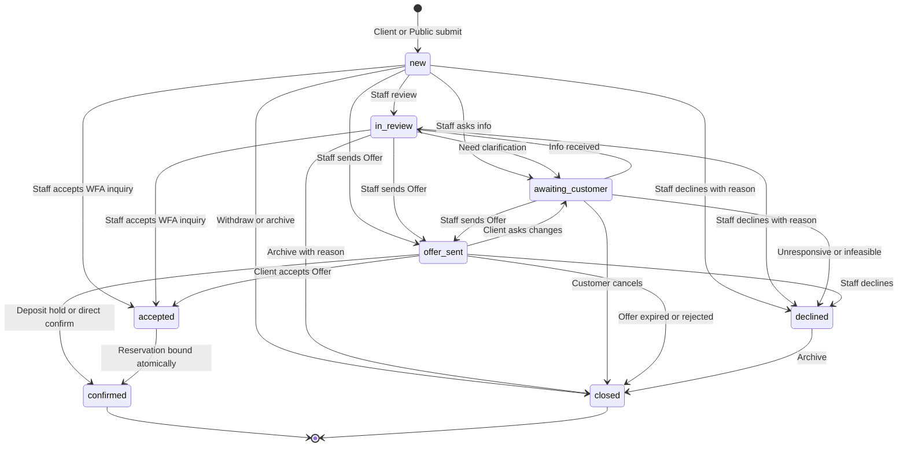

### 2.2 Allowed & Forbidden Transitions
- **Allowed Actors & Guards:**
  - `[*] -> new`: Public (`requestType` 33-key) or Client (`client_portal` 38-key); requires `linkedBookingId == null` and `linkedProjectId == null`.
  - `* -> declined | closed`: Staff/Owner ONLY with `statusReason.length >= 3`.
  - `* -> offer_sent`: Staff/Owner ONLY (`requestType == 'studio_booking'`) inside Offer transaction.
  - `offer_sent -> accepted`: Client (`clientUid == auth.uid`) OR Staff recording client verbal/WA confirmation inside Offer transaction (`acceptedOfferId != null`).
  - `accepted | offer_sent | new | in_review -> confirmed`: Staff/Owner ONLY inside `createBooking()` transaction when `requestType == 'studio_booking'`, `linkedBookingId != null`, and `bookings/{id}` exists after commit.
  - `new | in_review -> accepted` (`linkedProjectId != null`): Staff/Owner converting `post_production_inquiry` into `postProductionProjects`.
- **Forbidden Transitions:**
  - `post_production_inquiry -> confirmed` with `linkedBookingId != null`: Hard blocked by service & Rules (`AD-08`).
  - `confirmed | closed -> any`: Terminal states (`confirmed` history updates flow onto `clientReservations/{bookingId}`, NOT reopening the request!).
  - Any Client mutation of `status` outside guarded Offer acceptance/rejection.
- **Failure & Recovery:** If Client Offer acceptance fails network mid-flight, re-submit checks `offer.status === 'accepted'` and returns idempotent replay. If Staff conversion fails on `slot-conflict`, request stays `offer_sent` / `accepted` with zero partial writes.

---

## 3. State Machine 2 — Offer (`publicBookingRequests/{requestId}/offers/{offerId}.status`)

### 3.1 State Definitions
- `sent`: Active Offer revision awaiting Client decision (`now <= offerExpiresAt`).
- `accepted`: Client (or Staff on Client WA confirmation) formally accepted immutable Offer terms (`scheduleSnapshot`, `financialSnapshot`, `depositPolicySnapshot`).
- `rejected`: Client declined this revision (requires optional feedback reason; releases any `deposit_hold_offer` slots).
- `superseded`: Replaced atomically by a newer revision `offer_{n+1}` (`OD-13` Option A).
- `withdrawn`: Manually pulled back by Staff prior to acceptance (`OD-13` Option B or price/availability invalidation).
- `expired`: Offer validity deadline passed and marked expired manually by Staff.

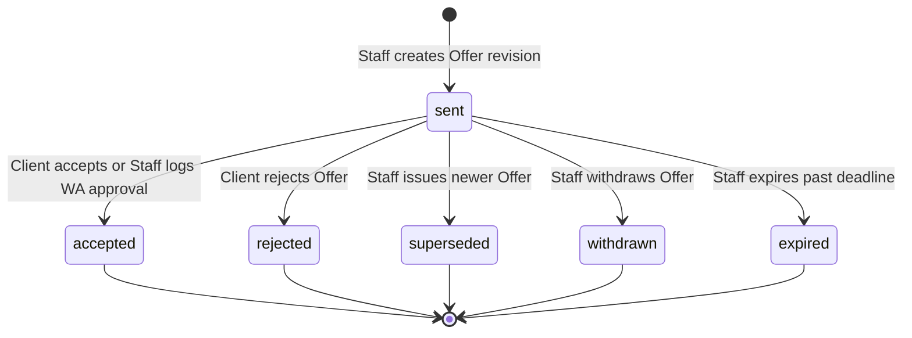

### 3.2 Guards, Forbidden Transitions & Recovery
- **Guards:** `sent -> accepted` requires `now <= offerExpiresAt`, `supersededByOfferId == null`, and exact `offer.version`. In `deposit_hold_offer` mode, verifies `bookings/{provisionalBookingId}.reservationStatus == 'deposit_hold'`.
- **Forbidden:**
  - `accepted -> any`: **100% immutable once accepted (`AD-02`, `AD-06`)!** Post-acceptance schedule/price modifications MUST go through `bookingChangeRequests` + `invoices/adjustments`.
  - `rejected | superseded | withdrawn | expired -> accepted`: Blocked in Rules & Service (prevents accepting stale lower prices!).
- **Recovery:** If Client rejects or Offer expires, Staff issues a brand-new Offer (`revisionNumber + 1`) rather than mutating the closed revision.

---

## 4. State Machine 3 — Reservation (`bookings.reservationStatus`)

### 4.1 State Definitions
- `deposit_hold`: Room slots (`bookingSlots`) and public occupancy (`publicAvailability`) are actively locked to protect the reservation while awaiting minimum Deposit fulfillment (`AD-01`). **Distinct from `confirmed` (`sessionStatus == 'pending_confirmation'`).**
- `confirmed`: Reservation is financially/administratively finalized (`sessionStatus` unlocked to `'upcoming'`). Studio session may now check in & run.
- `expired`: Manually released (`AD-05`) because deposit deadline elapsed without fulfilling requirements. Room `bookingSlots` & `publicAvailability` are deleted.
- `cancelled`: Manually cancelled by Studio (`studio_cancel`) or Client (`client_cancel`). Room `bookingSlots` & `publicAvailability` are deleted.

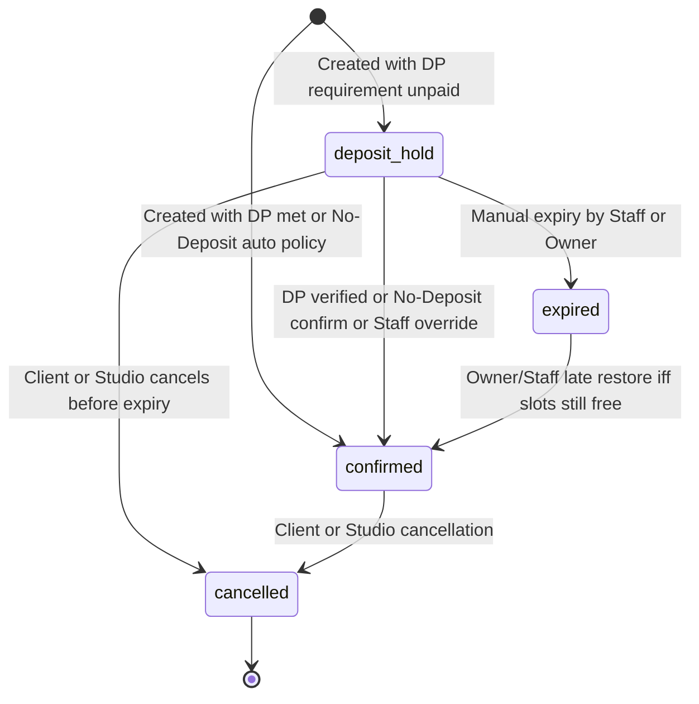

### 4.2 Allowed Transitions, Actors & Side Effects
| From -> To | Actor | Preconditions / Guards | Atomic Side Effects |
|---|---|---|---|
| `[*] -> deposit_hold` | Staff/Owner | Valid free 30m `bookingSlots`, `depositType != 'none'` and DP not yet verified | Locks `bookingSlots`, writes `publicAvailability` & `clientReservations`, creates `invoices`, sets `sessionStatus = 'pending_confirmation'`. |
| `[*] -> confirmed` | Staff/Owner | Admin Direct booking where `initialPaid >= minDeposit` OR `depositType == 'none' && OD-04 == auto` | Same locks, sets `sessionStatus = 'upcoming'`, `confirmedAt`. |
| `deposit_hold -> confirmed` (`deposit_verified`) | Staff/Owner (via `verifyEvidence` / `recordCash` per `OD-01`) | `invoice.netPaid >= depositPolicySnapshot.minimumDepositAmount` AND `bookingSlots` verified intact | Sets `sessionStatus: 'pending_confirmation -> upcoming'`, syncs `clientReservations`, appends `bookingEvents`. |
| `deposit_hold -> confirmed` (`staff_override`) | Authorized Staff / Owner (`OD-01`) | Mandatory `confirmationOverrideReason.length >= 5` | Sets `sessionStatus: 'upcoming'`, logs override audit event. |
| `deposit_hold -> expired` | Staff / Owner (`AD-05`) | **`pendingEvidenceCount == 0` (`OD-09`)**, mandatory `expiryReason` | Sets `sessionStatus -> 'cancelled'`, deletes ALL `bookingSlots` & `publicAvailability`, voids `invoice` if `paid == 0` else creates `refundCases`. |
| `deposit_hold \| confirmed -> cancelled` | Staff / Owner | `sessionStatus != 'completed'`, mandatory `cancellationReason` & `cancellationType` | Sets `sessionStatus -> 'cancelled'`, deletes ALL `bookingSlots` & `publicAvailability`, cancels open `bookingChangeRequests`, voids `invoice` if `paid == 0` else creates `refundCases`. |
| `expired -> confirmed` *(Reopening per `OD-10`)* | Owner / Auth Staff | **ALL target `bookingSlots` verified FREE**, `depositMet == true`, mandatory `restoreReason` | Re-creates `bookingSlots` + `publicAvailability`, unvoids/issues or keeps invoice, sets `sessionStatus: 'upcoming'`, logs `reservation_restored_from_expiry`. *(Blocked if any slot taken!)* |

- **Forbidden:**
  - Client direct mutation of `reservationStatus`.
  - `confirmed -> deposit_hold` via Reversal silently (if a verified DP is reversed on a future booking, Reservation triggers an Admin alert / flag `depositIntegrityAlert: true` rather than corrupting check-in silently!).
  - Cancelling after `sessionStatus == 'completed'` (`booking/invalid-transition`).

---

## 5. State Machine 4 — Payment & Invoice (`invoices` + `/adjustments`)

Invoice state separates **Document Lifecycle**, **Deposit Satisfaction**, and **Financial Balance**:
1. **`invoiceStatus`:** `issued` | `void` *(Phase 1+ recommendation: deprecate unused orphan `'draft'` status OR add strict `draft -> issued` Staff rule)*.
2. **`depositStatus`:** `not_required` | `awaiting_deposit` | `partial_below_minimum` | `met`.
3. **`paymentStatus`:** `unpaid` | `partial` | `paid` | `overpaid_credit_pending`.
4. **Computed UI State (`effectiveDueState`):** Overlays `'overdue'` client-side in `Asia/Jakarta` when `invoiceStatus == 'issued' && balanceDue > 0 && dueDate < todayWib`.

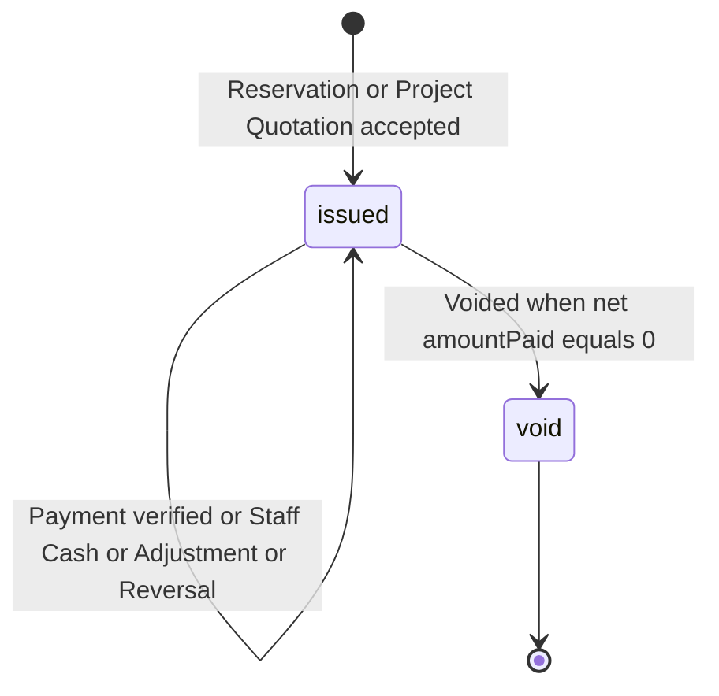

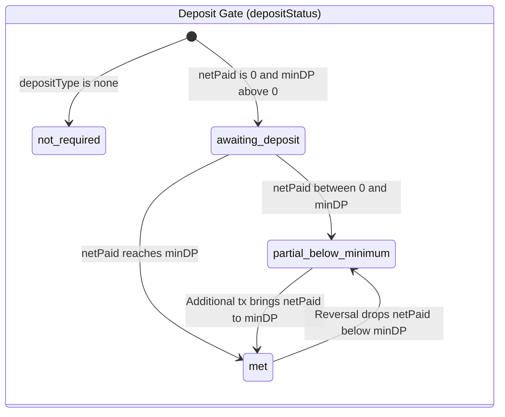

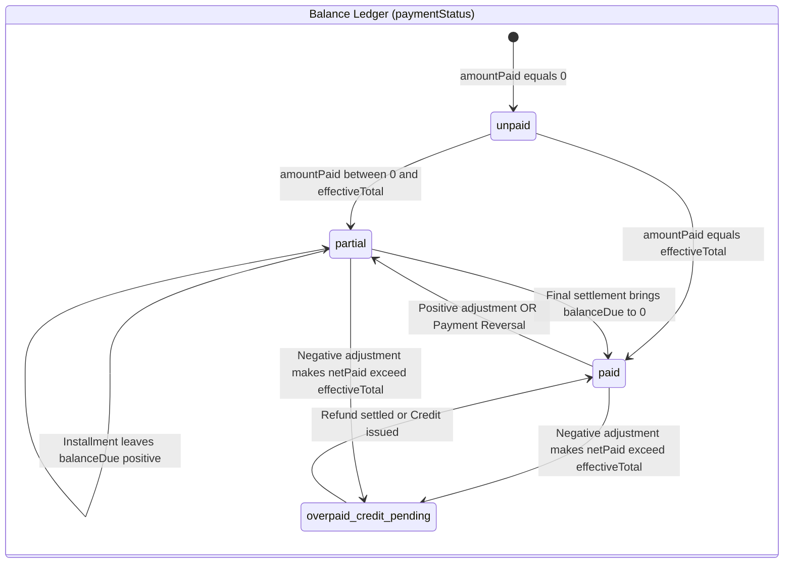

- **Forbidden Transitions:**
  - Recording payments or positive adjustments on `void` invoice.
  - `void -> issued`: Terminal! (Once voided with `amountPaid == 0`, cannot be revived unless `OD-10` expired-restoration issues an audit-logged replacement or un-voids via Owner tx).
  - Voiding an invoice when `amountPaid > 0`: MUST first resolve paid funds via `Payment Reversal` (if entry error) or `Refund Case` (if real money).
  - Overpaying `tx.amount > invoice.balanceDue`: Hard blocked in UI, Service, and Rules.

---

## 6. State Machine 5 — Payment Evidence (`paymentEvidence.status`)

### 6.1 Client Portal Proofs (`evidenceSource == 'client_portal'`) vs Admin Manual (`evidenceSource == 'admin_manual'`)
- `pending_review`: Uploaded by Client via Cloudinary unsigned preset (`paymentMethod != 'cash'`, `linkedTransactionId == null`).
- `verified`: Atomically verified by Staff/Owner -> writes `paymentTransactions/pay_evidence_{evId}` (`verifiedAmount <= invoice.balanceDue`) and updates `invoices`. **Terminal.**
- `rejected`: Rejected by Staff/Owner with `rejectionReason` (3..300 chars). Zero ledger mutation. **Terminal** (Client submits a new doc `ev_new` to resubmit!).
- `attached`: Created directly by Staff/Owner (`admin_manual`) alongside an Admin payment (`linkedTransactionId` bound). **Terminal.**

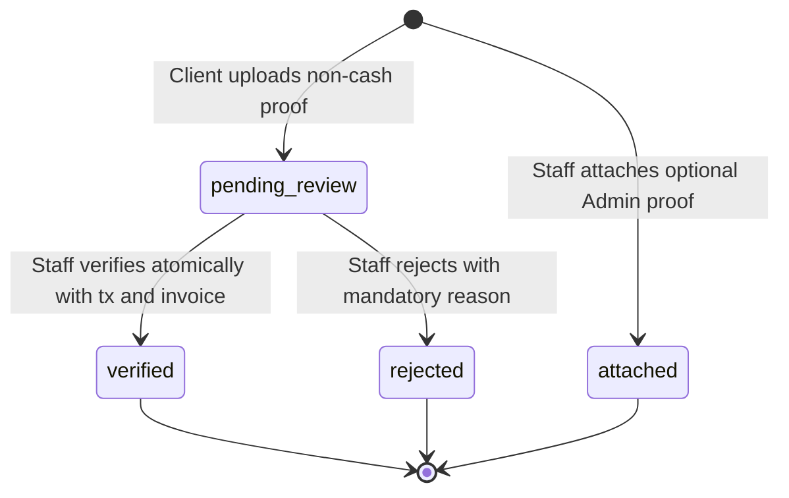

- **Forbidden Transitions:**
  - Client choosing `paymentMethod: 'cash'` (`AD-03`).
  - Client creating proof when `invoice.invoiceStatus == 'void'` or `balanceDue == 0`.
  - `verified -> rejected` or `verified -> pending_review` (to undo a mistakenly verified real tx, Staff executes `Payment Reversal` on `pay_evidence_{evId}`, preserving original `paymentEvidence` as historical verification audit!).
  - `rejected -> verified` (Client must submit a clean replacement document so rejected Cloudinary proof + reason remain intact).
- **Concurrency Recovery:** Two Staff racing to verify `ev_1` collide on `expectedEvidenceVersion` & `pay_evidence_{evId}`: winner succeeds; loser receives idempotent replay or `"Already reviewed"` without double-crediting `amountPaid`.

---

## 7. State Machine 6 — Session (`bookings.sessionStatus`)

Strictly governs **physical studio room execution**, decoupled cleanly from financial status (`paymentStatus`) and hold readiness (`reservationStatus`):
- `pending_confirmation`: Reservation exists ONLY as `deposit_hold` — room held, **cannot check in or start session**.
- `upcoming`: Reservation is `confirmed`, scheduled time approaching (`checkedInAt` optional once band arrives).
- `in_progress`: Session actively running (`actualStartedAt` set; eligible for live duration extension `bookingChangeRequests` / Admin extend).
- `completed`: Session concluded normally (`actualCompletedAt` recorded). Triggers Commission Batch & Review Invitation eligibility. **Terminal.**
- `no_show`: Client failed to check in (`!checkedInAt`) at `>= startMinute + 15 min` (`Asia/Jakarta`). Atomically deletes remaining `bookingSlots` & `publicAvailability`. **Terminal.**
- `cancelled`: Reservation held/confirmed was cancelled or hold expired manually. Room slots deleted. **Terminal.**

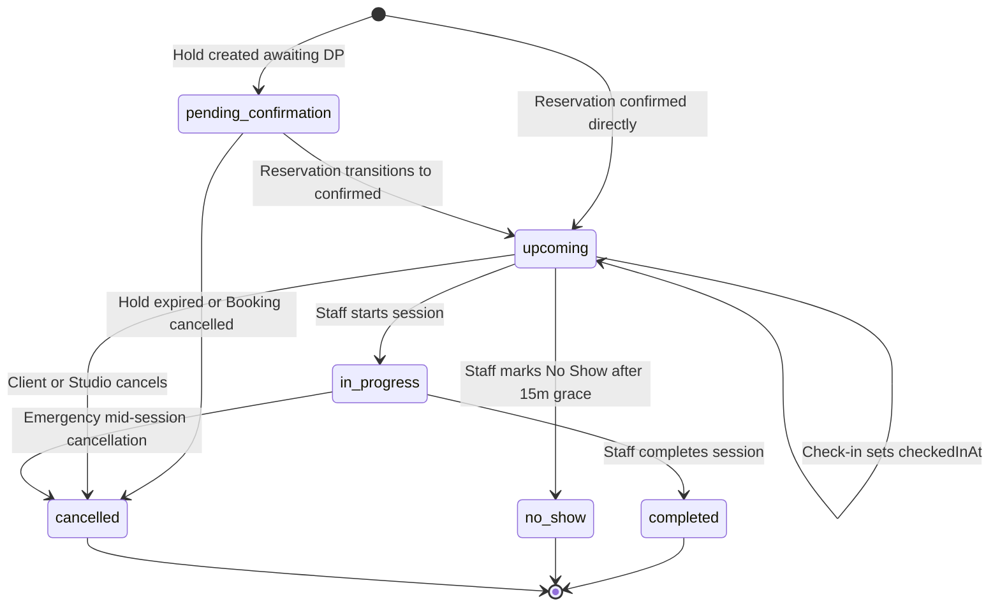

- **Key Forbidden Transitions (Enforced in BOTH Service & Phase 1+ Firestore Rules!):**
  - `pending_confirmation -> in_progress | completed`: Forbidden (`booking/deposit-hold-not-confirmed`).
  - `upcoming -> no_show` if `checkedInAt != null` or `now < start + 15m WIB`.
  - `completed | no_show | cancelled -> any` (immutable terminal execution logs — protects Commission batches & Review indexes!).

---

## 8. State Machine 7 — Change Request (`bookingChangeRequests.status`) (`AD-07`)

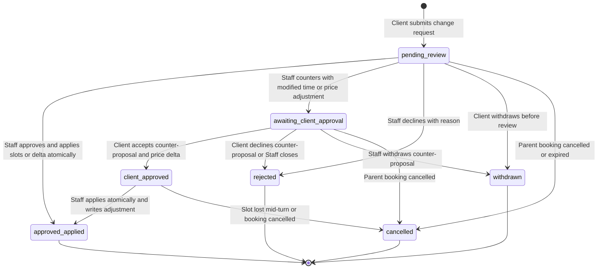

- **Atomic Safeguard:** `Client` can NEVER trigger `approved_applied` directly (`AD-07`, `FR-11`). When `awaiting_client_approval -> client_approved`, Client commits consent to pricing/schedule terms; Staff (or automatic single-click Staff Apply with fresh `bookingSlots` availability verification) runs `TX-07` so double-booking is impossible if another customer took the slot while the client was deciding!

---

## 9. State Machine 8 — Refund Case (`refundCases.status`) vs Payment Reversal (`AD-04`)

### 9.1 Clear Boundary: Refund Case vs Payment Reversal
- **`Payment Reversal`** = `paymentTransactions/{pay_rev_origTxId}` (`transactionType: 'reversal'`, append-only, zero `refundCases` doc): corrects clerical/entry errors (typo Rp, wrong booking, bounced transfer). **Never exits real cash from studio.**
- **`Refund Case`** = `refundCases/{refundId}`: governs actual customer claims to cash/bank refund or Studio Credit after valid money already landed (`paymentTransactions` stay intact forever!).

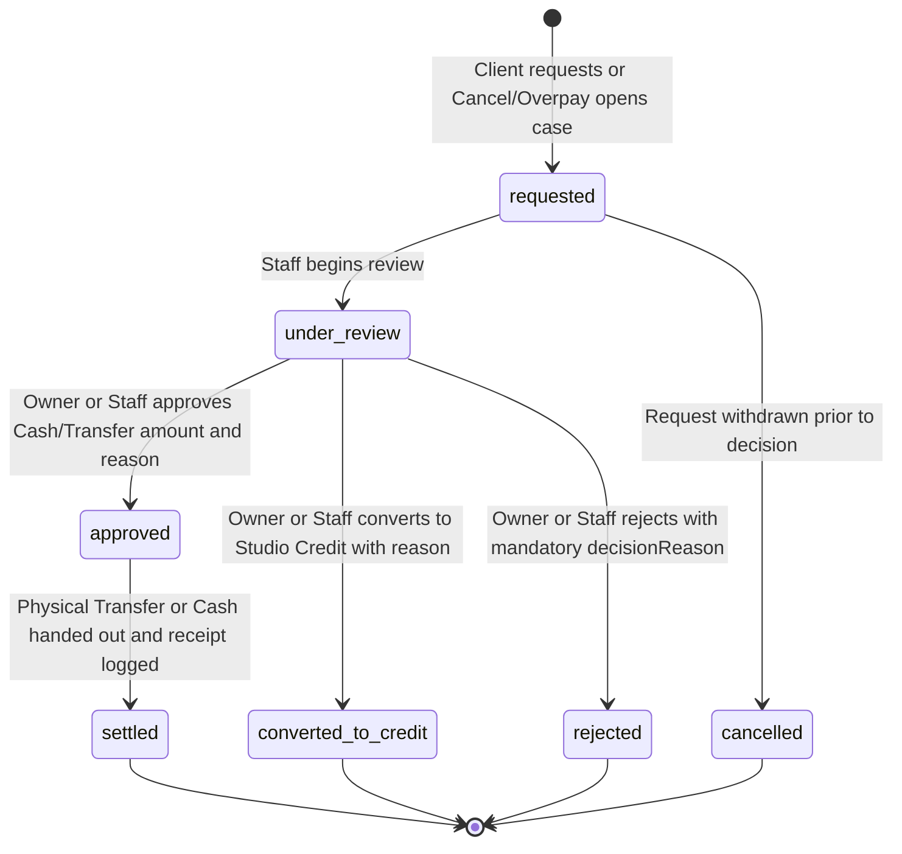

- **Strict Terminal Immutability:** `settled`, `converted_to_credit`, and `rejected` are terminal. `approvedAmount` MUST satisfy `0 < approvedAmount <= maxRefundableAmount` (`netPaid - alreadyRefunded`). `settled` triggers Pembukuan net cash deduction without mutating historical `paymentTransactions`.

---

## 10. State Machine 9 — Mix & Master Project (`postProductionProjects.status`) (`AD-08`)

Completely isolated from studio rooms (`bookings`, `bookingSlots`, `publicAvailability` NEVER exist).

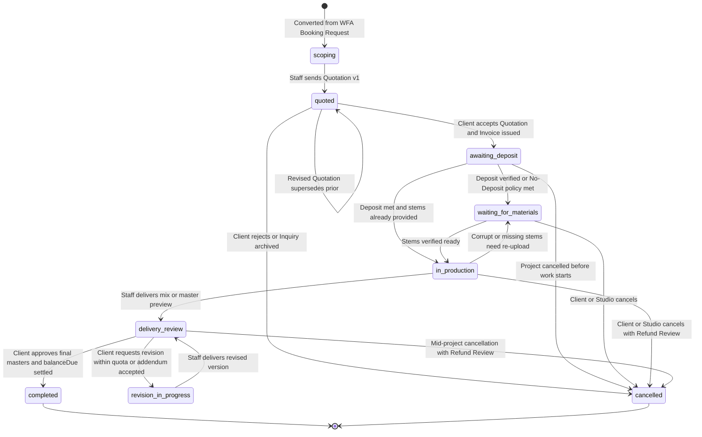

- **Financial Coupling on Project:** Accepting `quotations/{qtId}` issues `invoices/inv_prj_{projectId}`. Optional milestones (`50% DP`, `30% Rough Mix`, `20% Final`) track payment against the **single deterministic project invoice** using the exact same multi-method `paymentTransactions` + `paymentEvidence` (`!= cash` for client) + `staff_cash_desk` (`AD-03`) + `adjustments/` (for extra tracks/revisions) + `refundCases/` engine!

---

## 11. Cross-Lifecycle Coordination Matrix

| Trigger Event | Source Lifecycle -> Transition | Coupled Target Lifecycles (Atomic inside Same Transaction) | Guarded by Pending Decision |
|---|---|---|---|
| **Staff sends Deposit-Hold Offer** | `Offer: [*] -> sent` | `Request -> offer_sent`; `Booking: deposit_hold`; `Session: pending_confirmation`; `bookingSlots` LOCKED | Exact `holdExpiresAt` default rule (`OD-02`) |
| **Client accepts Quote-Only Offer** | `Offer: sent -> accepted` | `Request -> accepted`; Staff queues Reservation Hold creation | `OD-01`, `OD-04` |
| **Client accepts Deposit-Hold Offer** | `Offer: sent -> accepted` | `Request -> confirmed`; `Invoice -> issued`; if `deposit == 'none' && OD-04 == A` -> `Booking -> confirmed`, `Session -> upcoming` | `OD-01`, `OD-04` |
| **DP Verified / Staff Cash reaches min DP** | `Evidence -> verified` + `Tx created` + `Invoice.depositStatus -> met` | `Booking: deposit_hold -> confirmed`; `Session: pending_confirmation -> upcoming`; `clientReservations` synced; `bookingEvents` appended | **`OD-01` (TOP-3 BLOCKER)** |
| **Manual Hold Expiry Executed** | `Booking: deposit_hold -> expired` | `Session -> cancelled`; `bookingSlots` & `publicAvailability` DELETED; `Invoice -> void` (if `paid == 0`) OR `RefundCase -> requested` (if `paid > 0`) | `OD-09` (pending proof block), `AD-05` |
| **Change Request Approved & Applied** | `ChangeRequest -> approved_applied` | `bookingSlots` atomically swapped; `Booking` + `clientReservations` + `publicAvailability` updated; `Invoice/adjustments` created if price changed (+ `RefundCase` if overpaid) | `AD-06`, `AD-07`, `OD-11` |
| **Studio / Client Cancels Booking** | `Booking -> cancelled` | `Session -> cancelled`; `bookingSlots` & `publicAvailability` DELETED; open `ChangeRequests -> cancelled`; `Invoice -> void` (`paid == 0`) OR `RefundCase -> under_review` (`paid > 0`) | `AD-04`, `OD-12` |
| **Payment Reversal Posted** | `Tx(reversal)` created | `Invoice.amountPaid` decremented, `depositStatus` recomputed; if confirmed future booking drops below min DP, flags Staff hold review alert | Ledger audit rule |
| **Refund Case Settled** | `RefundCase: approved -> settled` | `Invoice.refundedTotal` incremented, `overpaidCreditBalance` cleared; Pembukuan subtracts outflow from net cash collected | `OD-12` |
| **Project Quotation Accepted** | `Quotation: sent -> accepted` | `Project: quoted -> awaiting_deposit`; `Invoice (inv_prj_...) -> issued` (`ZERO` `bookingSlots`!) | `AD-08`, `OD-03` |
